# PICKGO

**만날 장소부터 모두의 탑승까지, 함께 확인하는 픽업 약속판.**

- 운전자와 탑승자가 장소·준비·도착·탑승을 한 회차에서 공유.
- 한 명 픽업부터 여러 명의 공동 승차·지점별 진행까지 지원.
- 공모전 시연 자료: 실제 웹 앱 화면, 가상 사용 흐름, 별도 현대 내비 연동 증거.

[시연 영상 보기](docs/showcase/video/PICKGO_DEMO.mp4) · [전체 사용 설명서](docs/showcase/USER_GUIDE.md) · [시연 대본](docs/showcase/DEMO_SCRIPT.md) · [검증·촬영 정보](docs/showcase/VERIFICATION.md)

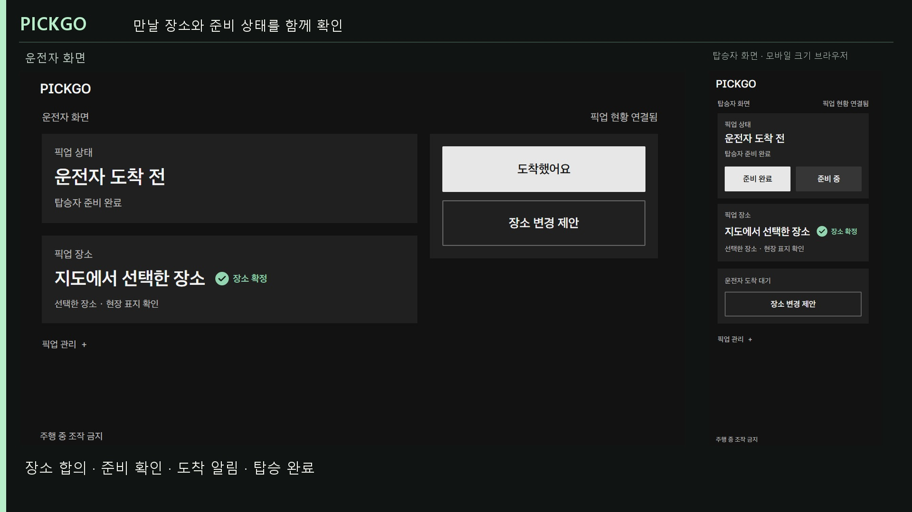

> 현재 단계: **로컬 웹 프로토타입 + 별도 Android 내비 연동 시연 앱**. 아래 웹 화면은 2026-11-06에 촬영했습니다. 이후 좌표 표시·모바일 레이아웃·초대 안내가 개선되어 현재 소스와 일부 화면 차이가 있습니다. 모바일 화면은 같은 PC의 모바일 크기 Chrome입니다. 실제 차량·공개 서비스·물리 휴대폰 연동 완료를 뜻하지 않습니다.

- 주차 등 조작 가능한 상황에서만 시연. 주행 중 조작 금지, 차량 주행 제한 연동 미완료.
- 영상은 실제 UI 화면 캡처를 편집한 설명 영상이며, 별도 2026-11-04 내비 녹화 발췌를 포함합니다. 하나의 회차를 연속 녹화한 영상은 아닙니다.

## 화면으로 보는 사용 흐름

### 01. 어디서 태울지 검색하고 선택

- `하나로마트` 등 장소 이름 검색.
- 양재 주변 OSM 수록 장소에서 검색 결과·주변 픽업 후보 확인.
- 후보를 선택하거나 지도에서 직접 지점 지정.
- 일부 차단 영역을 표시하며, 정차 가능 여부는 현장 확인 필요.

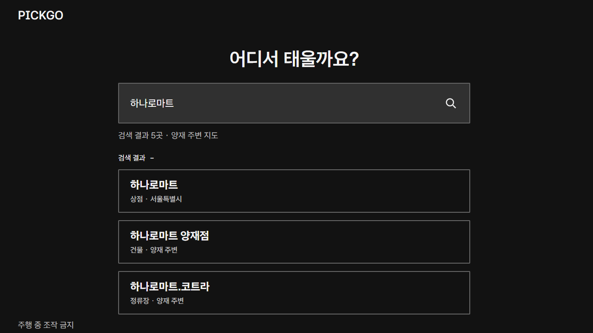
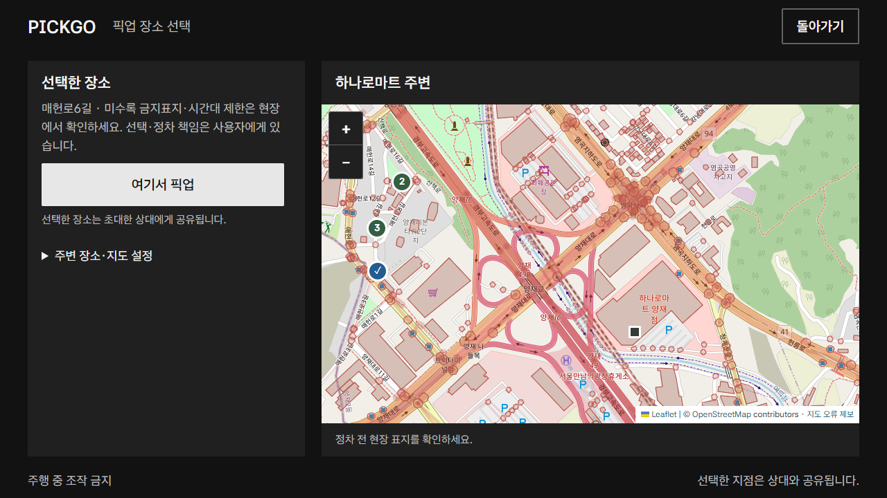

### 02. 링크로 초대하고 준비 상태 확인

- 운전자: 픽업 생성 → 초대 링크 복사 → 직접 전달.
- 탑승자: 링크 열기 → 참여 → 준비 완료.
- 상대 참여·최신 상태 확인 후 장소 확정 표시.
- 위치 공유는 선택. 공유하지 않아도 기본 흐름 이용 가능.

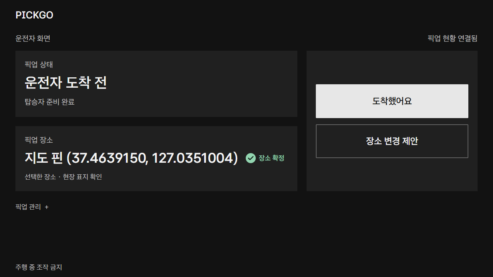

| 초대받은 탑승자 | 준비 완료 |
|---|---|
| 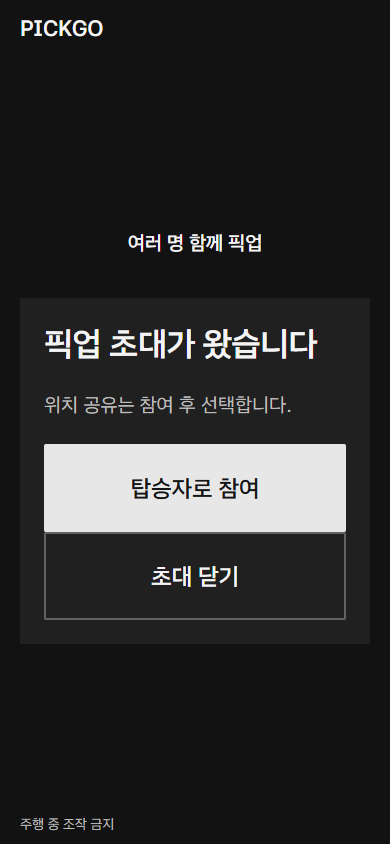 | 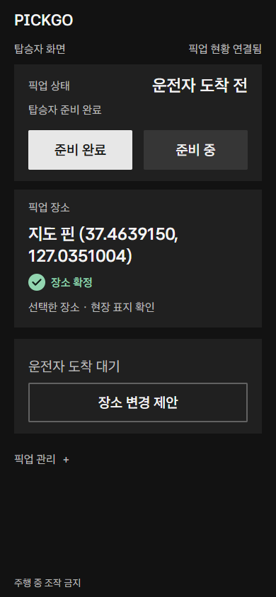 |

### 03. 장소가 바뀌면 상대와 합의

- 양쪽 모두 장소 변경 제안 가능.
- 상대가 수락해야 확정 장소 변경.
- 현재 장소 유지·제안 철회 지원.
- 합의 전까지 기존 장소 유지.
- 고정 목록의 이름 기반 변경은 내비용 확정 좌표 선택과 구별. 내비 연결은 OSM 확정 좌표가 있는 단일 회차에서만 시연.

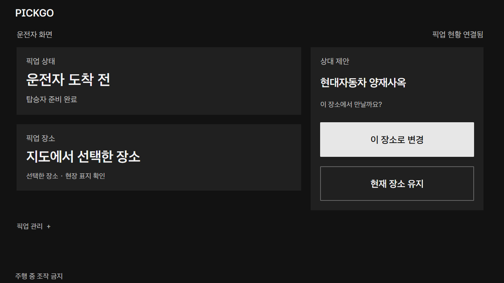

### 04. 도착·탑승을 확인하고 종료

- 운전자: `도착했어요`.
- 탑승자: `탑승했어요`.
- 실수한 도착·탑승 표시 취소 지원.
- 운전자: 종료 확인 → 픽업 완료.
- 탑승 전 종료는 취소로 구분. 위치로 자동 완료하지 않음.

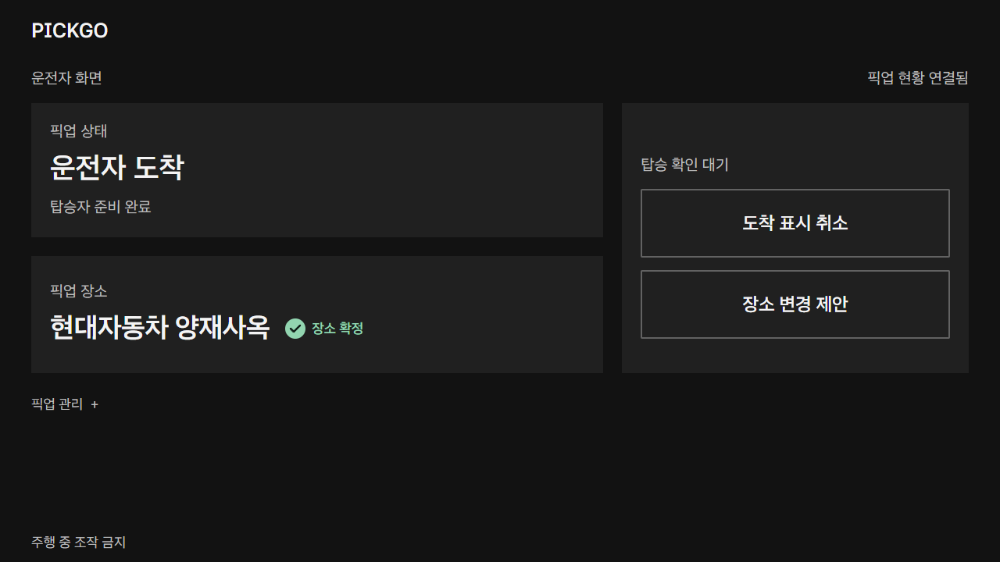
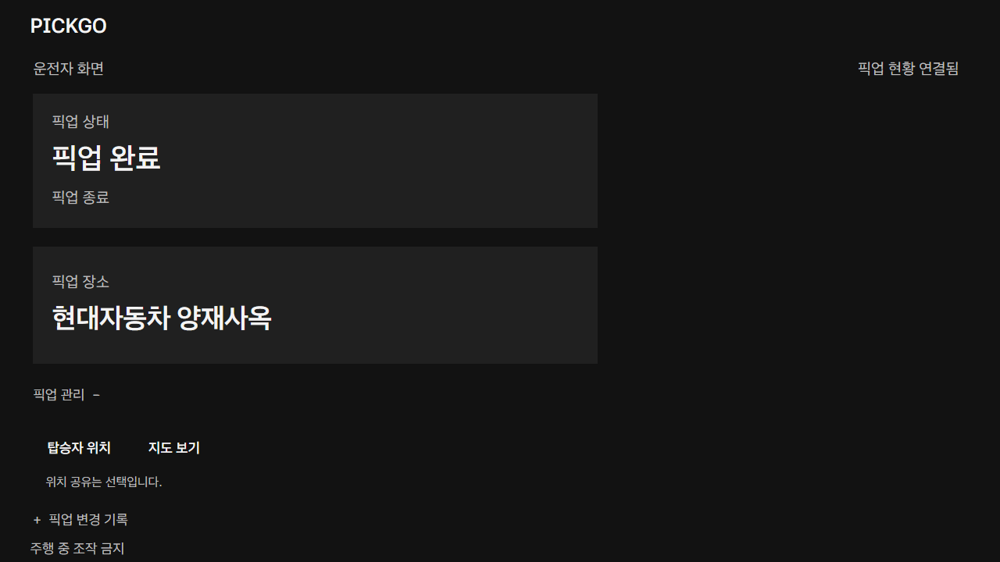

### 05. 여러 명도 지점별로 진행

- 사람별 이름·지점·독립 초대 링크 관리.
- 같은 지점 함께 승차 지원.
- 순서 수동 편집 → 다음 지점 선택 → 도착 → 사람별 탑승 확인.
- 같은 지점의 모든 사람이 탑승·취소되어야 다음 지점 진행.
- 모두 탑승 / 일부 탑승·일부 취소 / 모두 취소 결과 구분.
- 회차당 취소 인원을 포함해 총 6명. 실제 차량 정원 준수 필요.

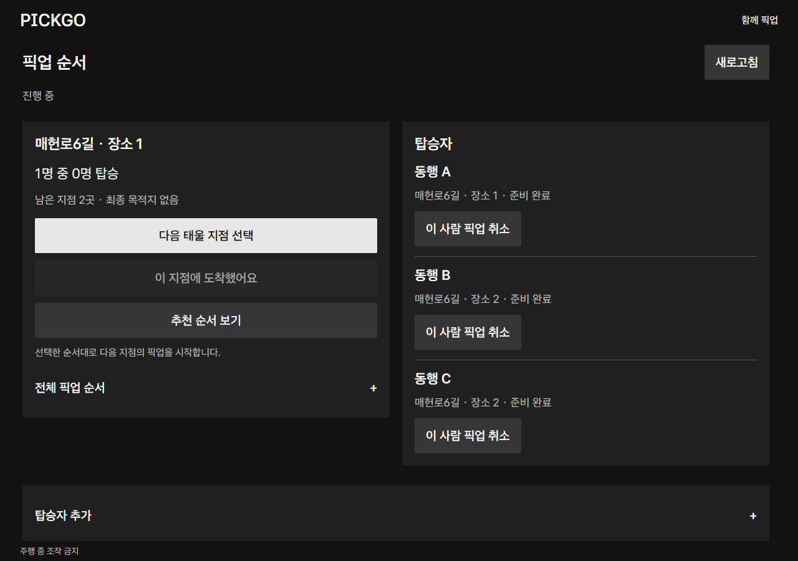

### 06. 확정 좌표로 현대 내비 안내 시작

- 별도 Android 앱의 명시적 native 버튼에서 NaviHelper 3.0.5 호출.
- 단일 회차의 OSM 확정 좌표·역할·최신 합의 상태 재검증.
- Pleos 에뮬레이터에서 목적지 일치·안내 중 상태·45초 결과 유지 확인.
- 다인 픽업의 현대 내비 다중 경유는 미연결.
- 아래 화면은 **별도 2026-11-06 통합 검증** 자료. 최신 웹 디자인과 동일 빌드의 연속 촬영본은 아님.

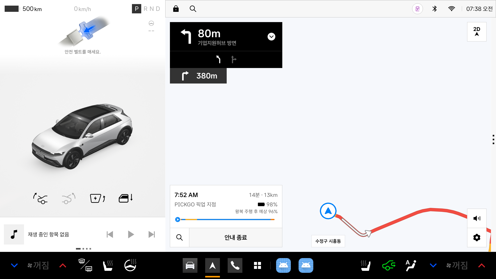

[Android 실행 안내](experiments/pickgo-navigation/README.md) · [연동 검증 기록](docs/IMPLEMENTATION_STATUS.md)

## 전체 기능 한눈에 보기

| 구분 | 기능 | 현재 범위 |
|---|---|---|
| 장소 찾기 | 이름·도로·주소 검색, 주변 후보 | 양재 주변 OSM 스냅샷 |
| 지도 | 확대·축소, 직접 핀 선택, 일부 차단 영역, 후보 확인 | Leaflet·OSM, 정차 합법성 보장 아님 |
| 초대 | 링크 복사·열기, 참여, 동일 탭 복원·재시도 | 로컬 브라우저, 자동 메시지 전송 없음 |
| 준비 | 준비 완료·준비 중, 상대 상태 반영 | 단일·다인 |
| 장소 합의 | 제안·수락·거절·철회, 확정 표시 | 단일 회차 |
| 픽업 진행 | 수동 도착·탑승, 표시 취소, 종료·새 시작 | 단일 회차 |
| 위치 공유 | 명시 동의, 일회 공유·거부·중지·삭제 | 브라우저 기능, 물리폰 HTTPS 검증 별도 |
| 다인 픽업 | 총 6명 초대, 공동 지점, 수동 순서, 사람별 취소·완료 | 실제 도로시간·다중 내비 미연결 |
| 상태·복구 | 변경 기록, 새로고침, 오래된 상태 제한, 회차 만료 안내 | 메모리 저장·영구 이력 없음 |
| 내비 안내 | OSM 확정 좌표 전달, 목적지·안내 상태 관찰 | 별도 Android/Pleos 에뮬레이터 확인 |
| 개발 시연 전용: 순서 추천 | 합성 시간 행렬 기반 순서 비교·명시 적용 | 일반 화면 설정 숨김, 실제 도로시간 아님 |
| 개발 시연 전용: 지점 추천·차량 근접 | 합성 위치·경로 기반 추천·근접 판정 | 시연 입력 숨김, 실제 차량 데이터 미연결 |
| Gleo·routo | 어댑터·계약·시험 준비 | 실제 서비스 통합 미완료 |

전체 조작, 보관·삭제, 오류 복구와 개발용 기능 조건은 [사용 설명서](docs/showcase/USER_GUIDE.md)에 정리했습니다.

## 기술 스택

| 영역 | 사용 기술 | 역할 |
|---|---|---|
| 웹 UI | HTML5, CSS3, JavaScript ES Modules | 운전자·탑승자 반응형 화면, 별도 UI 프레임워크 없음 |
| 로컬 서버 | Node.js 22+, `node:http` | 회차·초대·역할별 API, 메모리 상태 관리 |
| 상태 동기화 | Fetch API, 주기 조회, AbortSignal | 최신 상태 표시·시간 초과 처리 |
| 세션·검증 | sessionStorage, 임시 토큰, 버전·조회 유효기간·요청 ID | 역할 분리, 오래된/중복 변경 차단 |
| 지도 | Leaflet 1.9.4, OpenStreetMap | 지도 표시, 로컬 양재 데이터 검색·지점 검사 |
| 위치 | Web Geolocation API | 동의 기반 탑승자 위치 공유 |
| Android | Java 17, Android WebView, AGP 8.7.3, Gradle 8.9 | 별도 native 시연 wrapper |
| Android 기준 | minSdk 28, compileSdk/targetSdk 34 | 현재 빌드 설정 |
| 내비 SDK | Pleos NaviHelper 3.0.5 | 단일 확정 목적지 전달·안내 상태 관찰 |
| 글꼴 | 로컬 Asta Sans, OFL 1.1 | 화면 타이포그래피 |
| 검증 | Node.js 내장 test, 실제 Chrome, Java RouteGate 시험, Pleos 에뮬레이터 | 도메인·HTTP·화면·내비 경계 확인 |

- 지도 출처: © OpenStreetMap contributors, ODbL. 화면에 지도 출처 유지.
- 글꼴·라이브러리 라이선스: [fonts](experiments/pickup-board/fonts/), [Leaflet vendor](experiments/pickup-board/map/vendor/).
- 스택 버전은 저장소 설정 기준. 문서 기재가 모든 기기 호환성을 보장하지 않음.

## 실행과 테스트

### 웹 시연

```sh
npm start
```

- 접속: `http://127.0.0.1:4180`.
- 운전자에서 초대 생성 → 같은 PC의 별도 탭에서 탑승자로 참여.
- 외부 API 키 없이 로컬 검색·픽업 가능. 배경 지도 타일은 인터넷 연결 필요.
- 서버 재시작 시 회차 소실. 기본 회차 최대 24시간, 지속 저장 아님.
- 다른 휴대폰 접속에는 별도 HTTPS·접속 구성 필요.
- 지도 데이터 만료 시 갱신 필요. 초대 참여 재시도 복원은 같은 브라우저에서 첫 요청 후 5분 이내 범위이며 탭 종료 후 복원은 보장하지 않음.

```sh
npm test
```

- 현재 소스의 마지막 웹 자동시험: **261/261 통과**. 영상 촬영 시점의 시험은 259개였으며 이후 UI 개선 회귀가 추가됐습니다.
- 실제 Chrome 시연: 단일 픽업 완료, 다인 3명·2지점·공동 승차·전체 완료 확인.
- 별도 2026-11-06 내비 검증: RouteGate 43 assertions, debug 빌드·lint, 에뮬레이터 목적지 일치·안내 확인. 이번 촬영에서 APK를 재빌드·재검증한 것은 아님.
- [검증 정보·재현](docs/showcase/VERIFICATION.md) · [상세 개발 실행 안내](experiments/pickup-board/README.md).

### APK 위치와 제출 상태

- 현재 로컬 debug APK: `experiments/pickgo-navigation/app/build/outputs/apk/debug/app-debug.apk`.
- build 폴더는 Git 제외 대상. 저장소 복제만으로 APK가 내려오지 않음.
- 실행 환경·SDK·기존 debug 키 요구사항: [Android 안내](experiments/pickgo-navigation/README.md).
- 공모전 제출용 release APK 및 `apk/` 제출 경로는 아직 준비·검증되지 않음.
- 웹 시연은 실제 SDK 연동을 요구하지 않으며, native 안내 시연은 Pleos 환경·NaviHelper가 필요.

## 제출 자료 안내

- [전체 사용 설명서](docs/showcase/USER_GUIDE.md): 기능별 조작·오류 복구·제약.
- [시연 영상](docs/showcase/video/PICKGO_DEMO.mp4): 2분 6초, 한국어 설명, 무음.
- [시연 대본](docs/showcase/DEMO_SCRIPT.md): 가상 시나리오와 장면 구성.
- [구현·검증 범위](docs/IMPLEMENTATION_STATUS.md): 웹·합성 데이터·SDK 실행 구분.
- [촬영 정보](docs/showcase/VERIFICATION.md): 촬영 환경·편집·버전 차이.
- [오픈소스·데이터 출처](docs/THIRD_PARTY_NOTICES.md).

현재 미완료: 실차·차량 UX 제한, 공개 HTTPS 운영, 물리폰 전체 연동, 실제 도로시간 추천, 현대 내비 다중 경유, Gleo/routo 본연동, release 제출 검증.
