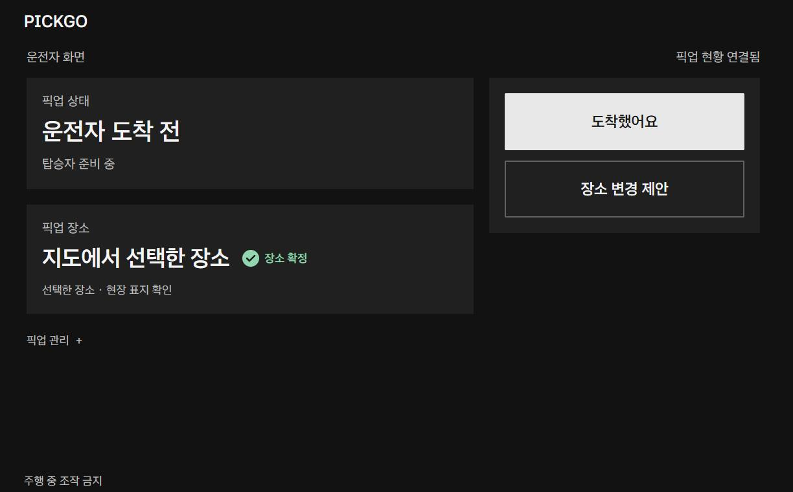
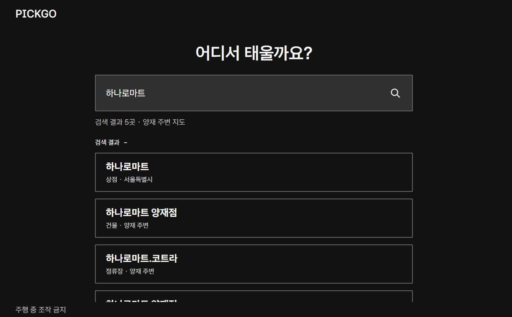
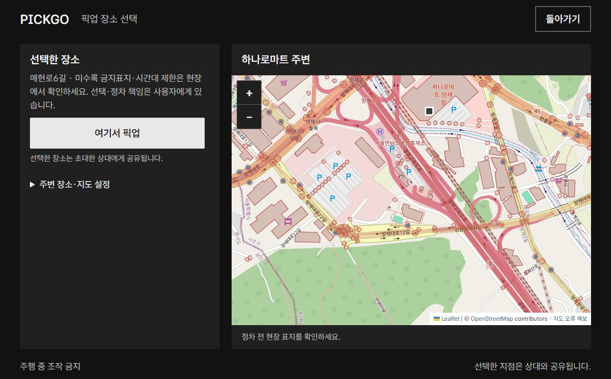
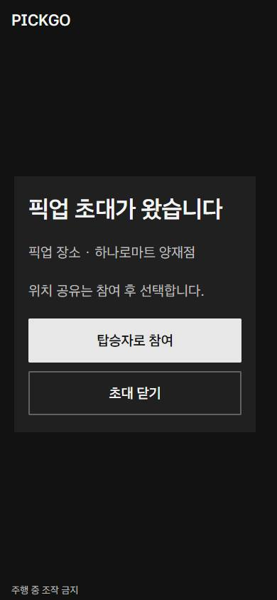
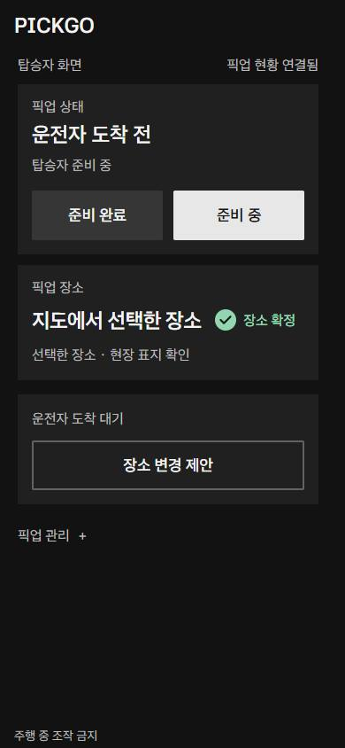
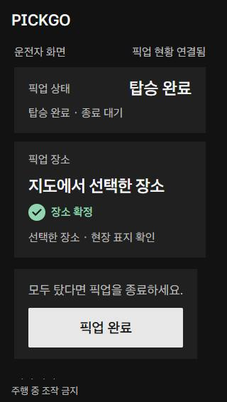
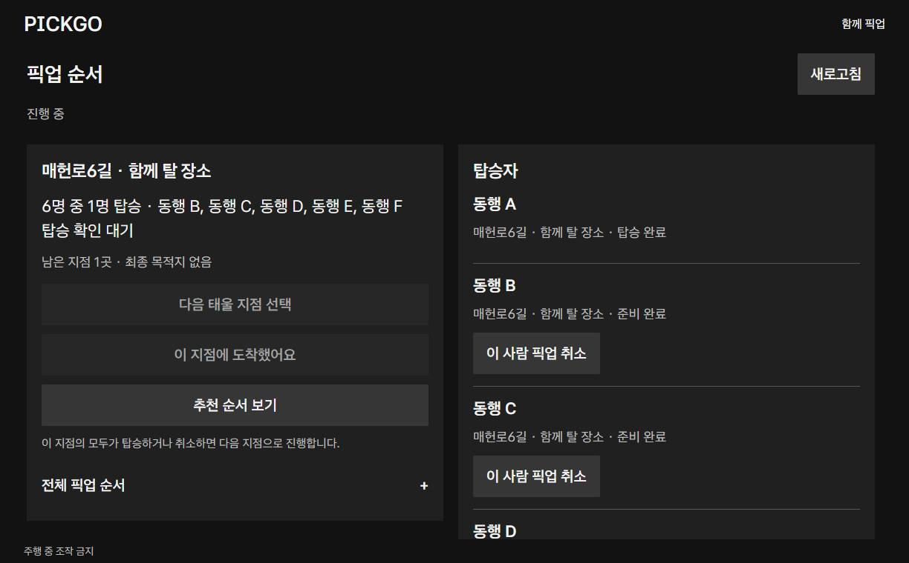
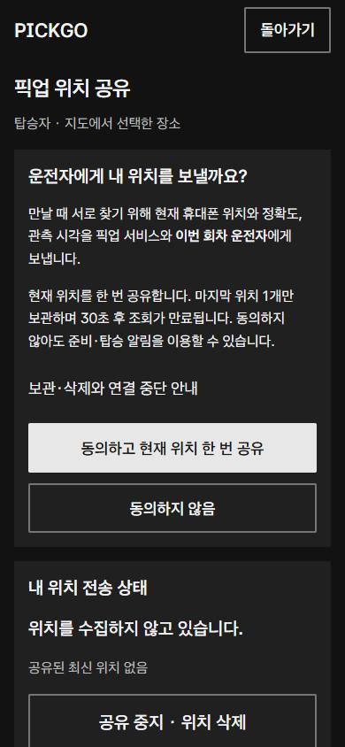

# PICKGO

### 만날 장소부터 모두의 탑승까지, 함께 확인하는 픽업 약속판

**“어디서 만나지?”, “준비됐어?”, “도착했어?”를 하나의 픽업 흐름으로 연결합니다.**

- **운전자:** 장소를 정하고 동행을 초대한 뒤 준비·도착·탑승 상태 확인.
- **탑승자:** 초대 링크에서 참여하고 준비 완료·장소 변경·탑승 알림.
- **여러 명:** 사람별 초대, 공동 승차 지점, 픽업 순서와 남은 인원 관리.

[시연 영상](docs/showcase/video/PICKGO_DEMO.mp4) · [전체 사용 설명서](docs/showcase/USER_GUIDE.md) · [구현·검증 범위](docs/IMPLEMENTATION_STATUS.md) · [실행 방법](#실행-방법)



> 현재 단계는 **로컬 웹 프로토타입과 별도 Android 내비 연동 시연 앱**입니다. 이 README의 웹 화면은 2026-11-06 UI 개선 검증본입니다. 모바일 이미지는 실제 휴대폰 촬영이 아닌 모바일 크기의 Chrome 화면입니다. 주차 등 조작 가능한 상황에서만 시연하며, 주행 중 조작은 금지합니다.

## 화면으로 보는 사용 흐름

### 1. 픽업 장소 검색·지도 선택

- 장소 이름을 검색하고 주변 픽업 후보 확인.
- 후보의 순번과 검색 장소 기준 직선거리 비교.
- 후보를 선택하거나 지도에서 지점을 직접 지정.
- 현재 검색 범위는 양재 주변 OSM 수록 장소·도로·주소.
- 지도에서 일부 차단 영역 표시. 선택 가능 표시는 합법 정차 인증이 아니므로 현장 표지 확인 필요.

| 장소 검색 | 지도에서 확인 |
|---|---|
|  |  |

### 2. 초대 링크로 참여·준비 확인

- 운전자: 픽업 생성 → 초대 링크 복사 → 직접 전달.
- 탑승자: 참여 전 픽업 장소 확인 → `탑승자로 참여` → `준비 완료`.
- 장소와 현재 상태를 역할에 맞는 화면에서 확인.
- 준비 완료와 준비 중은 언제든 해당 상태에서 변경 가능.
- 앱 설치·회원가입 없이 웹 참여. 기본 로컬 실행에서는 같은 컴퓨터의 별도 탭 사용.

| 장소를 확인하고 참여 | 휴대폰 크기에 맞춘 탑승자 화면 |
|---|---|
|  |  |

### 3. 장소 변경은 서로 동의한 뒤 확정

- 운전자·탑승자 모두 장소 변경 제안 가능.
- 상대의 수락 전까지 기존 장소 유지.
- 상대: 새 장소 수락 또는 현재 장소 유지.
- 제안자: 제안 철회 가능.
- 상대 참여·최신 상태·진행 중·변경 제안 없음 조건에서 장소 확정 표시.
- 지도에서 선택한 좌표는 저장·내비 전달에 유지하고, 기본 화면은 사람이 읽기 쉬운 장소 안내로 표시.
- 고정 목록의 이름 기반 장소 변경과 내비 전달용 좌표 선택은 구분.

### 4. 도착·탑승 확인 후 픽업 완료

- 운전자: 실제 도착 후 `도착했어요`.
- 탑승자: 실제 탑승 후 `탑승했어요`.
- 잘못 누른 도착·탑승 표시 취소 지원.
- 탑승 확인 후 운전자 화면의 주요 버튼으로 `픽업 완료` → 종료 확인.
- 탑승 전 종료는 취소로 구분. GPS 근접만으로 도착·탑승을 자동 확정하지 않음.



### 5. 여러 명을 지점별로 픽업

- 사람별 이름·승차 지점·독립 초대 링크 관리.
- 같은 지점에서 탈 사람은 `같은 지점 함께 승차`로 묶기.
- 지점 순서 수동 편집 → 다음 지점 선택 → 도착 → 각자 탑승 확인.
- 현재 지점의 탑승 인원과 확인 대기 이름을 함께 표시.
- 같은 지점의 모든 사람이 탑승 또는 취소된 뒤 다음 지점으로 진행.
- 모두 탑승 / 일부 탑승·일부 취소 / 모두 취소 결과 구분.
- 취소한 사람까지 회차 총 6명. 차량 정원은 별도로 준수.



### 6. 위치 공유는 선택

- 참여한 탑승자가 목적·보관 안내를 읽고 일회 공유에 동의.
- 공유하지 않아도 준비·장소 합의·탑승 기능 이용 가능.
- 공유 중지·위치 삭제 지원. 마지막 위치 1개만 메모리에 보관.
- 관측 후 30초에 조회 만료, 다음 정리 주기에 제거. 연결 단절 시 삭제 요청 도착은 보장되지 않음.
- 실제 휴대폰 HTTPS 전체 흐름 검증은 미완료.



### 7. 확정 지점으로 현대 내비 안내

- 별도 Android 앱의 명시적 안내 버튼에서 **Pleos NaviHelper 3.0.5** 호출.
- 단일 회차의 OSM 확정 좌표·운전자 역할·최신 합의 상태를 다시 검사한 뒤 목적지 전달.
- Pleos 에뮬레이터에서 목적지 일치·안내 중 상태와 45초 관찰 후 결과 유지 확인.
- 다인 픽업의 실제 현대 내비 다중 경유는 미연결.
- 아래는 별도 내비 검증 화면이며, 최신 웹 UI와 같은 빌드의 연속 시연은 아님. 내비 영상의 탑승자 참여는 테스트용 브라우저 자동화(CDP participant)이며 물리폰 참여가 아님.


[Android 실행 안내](experiments/pickgo-navigation/README.md)

## 전체 기능과 구현 범위

| 영역 | 기능 | 상태 |
|---|---|---|
| 장소 | 검색·주변 후보·직접 지도 선택·일부 차단 영역 | 양재 OSM 로컬 데이터 |
| 초대 | 장소 미리보기·링크 복사·참여·같은 탭 복원·재시도 | 웹 구현, 메시지 자동 발송 없음 |
| 합의·상태 | 준비·장소 제안/수락/거절/철회·확정 표시 | 단일 픽업 구현 |
| 진행 | 도착·탑승·표시 취소·종료·새 시작 | 수동 확인 |
| 위치 | 동의·일회 공유·거부·중지·삭제 | 브라우저 구현, 실제 기기 검증 별도 |
| 다인 | 총 6명 초대·공동 지점·수동 순서·사람별 취소·결과 구분 | 실제 도로시간·다중 내비 미연결 |
| 오류·복구 | 변경 기록·새로고침·오래된 상태 제한·회차 만료 안내 | 메모리 저장, 영구 계정·이력 없음 |
| 내비 | 단일 확정 목적지 전달·안내 상태 관찰 | 별도 Android/Pleos 에뮬레이터 확인 |
| 개발 시연 | 합성 이동시간 순서 추천·지점 추천·근접 판정 | 합성 데이터 전용, 일반 화면 일부 설정 숨김 |
| 연동 준비 | Gleo·routo 어댑터·계약·시험 | 실제 서비스 통합 미완료 |

## 기술 스택

| 영역 | 기술 |
|---|---|
| 웹 화면 | HTML5 · CSS3 · JavaScript ES Modules · 반응형 레이아웃 |
| 서버 | Node.js 22+ · node:http · 메모리 기반 회차 관리 |
| 동기화·세션 | Fetch API · 주기 조회 · AbortSignal · sessionStorage · 임시 토큰 |
| 상태 검증 | 역할·버전·조회 유효기간·일회 요청 ID 확인 |
| 지도·위치 | Leaflet 1.9.4 · OpenStreetMap · Web Geolocation API |
| Android | Java 17 · Android WebView · AGP 8.7.3 · Gradle 8.9 |
| Android SDK 기준 | minSdk 28 · compileSdk/targetSdk 34 |
| 내비 | Pleos NaviHelper 3.0.5 |
| 글꼴 | Asta Sans · SIL OFL 1.1 |
| 시험 | Node 내장 test · Chrome 화면 검사 · Java RouteGateTest · Pleos 에뮬레이터 |

[라이선스·데이터 출처](docs/THIRD_PARTY_NOTICES.md)

## 실행 방법

### 웹 시연

Node.js 22 이상에서 저장소를 내려받은 뒤 실행합니다. 별도 npm 패키지 설치 없이 시작할 수 있습니다.

```sh
git clone https://github.com/usechan0528-max/HYUNDAI_AI.git
cd HYUNDAI_AI
npm start
```

- 브라우저: `http://127.0.0.1:4180`.
- 운전자 화면에서 초대를 만들고 같은 컴퓨터의 별도 탭에서 참여.
- 외부 API 키 없이 기본 시연 가능. OSM 배경 지도에는 인터넷 연결 필요.
- 다른 휴대폰 접속에는 HTTPS·접속 구성 필요.
- 서버 재시작 시 메모리 회차 소실, 회차 최대 24시간.
- 지도 데이터는 수집 시점부터 7일 유효. 만료 시 [지도 갱신 안내](experiments/pickup-board/map/README.md) 참고.

### 테스트

```sh
npm test
```

- 현재 구현의 마지막 확인 결과: **261개 시험 통과**.
- 화면: **7개 크기·89개 레이아웃/상태 검사 통과**.
- 내비 정책: **RouteGateTest 43 assertions 통과**, 별도 에뮬레이터 목적지·안내 상태 확인.
- 숫자는 기록된 실행 집합의 결과이며 모든 기기·실차 검증을 뜻하지 않음.

### Android 시연 및 APK

- [별도 Android 실행 절차](experiments/pickgo-navigation/README.md) 참조.
- JDK·Gradle·Android/Pleos SDK와 기존 키를 포함한 로컬 환경 설정 필요. Android 안내의 도구 경로는 예시이며 본인 환경에 맞게 변경해야 함.
- 개발용 debug 출력: `experiments/pickgo-navigation/app/build/outputs/apk/debug/app-debug.apk`.
- 빌드 산출물·키·SDK 바이너리는 저장소에 포함하지 않음.
- 제출용 release APK 생성·서명·배포 검증은 미완료.

## 시연 자료

- [2분 6초 시연 영상](docs/showcase/video/PICKGO_DEMO.mp4): 단일 픽업 → 3명·2지점 공동 승차 → 별도 내비 연동.
- 영상은 최신 웹 UI를 다시 조작해 만든 한국어 설명·무음 편집본. 저빈도 화면 캡처를 편집한 자료이며 연속 실시간 녹화는 아님.
- 내비 구간은 2026-11-04 별도 에뮬레이터 촬영본. 실제 차량 촬영이 아님.
- [사용 설명서](docs/showcase/USER_GUIDE.md) · [시연 대본](docs/showcase/DEMO_SCRIPT.md) · [촬영 정보](docs/showcase/VERIFICATION.md).

## 남은 검증

- 실차·차량 주행 UX 제한, 공개 HTTPS 운영, 물리폰 전체 흐름.
- 실제 도로시간 추천, 현대 내비 다중 경유, Gleo/routo 본연동.
- release APK 생성·서명·배포 검증.

자세한 구분은 [구현·검증 범위](docs/IMPLEMENTATION_STATUS.md)에서 확인할 수 있습니다.
