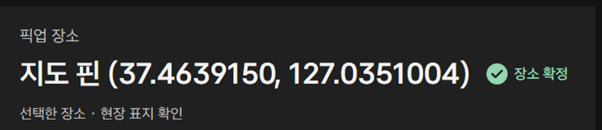
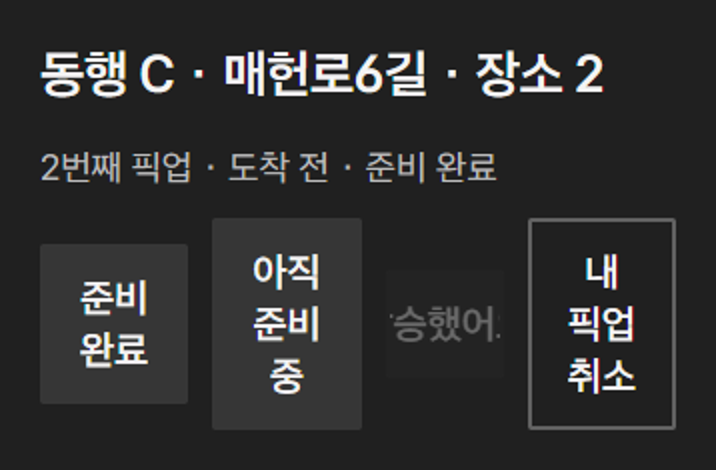
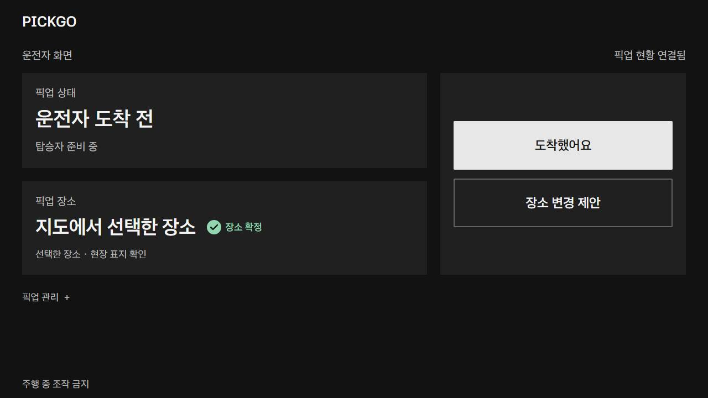
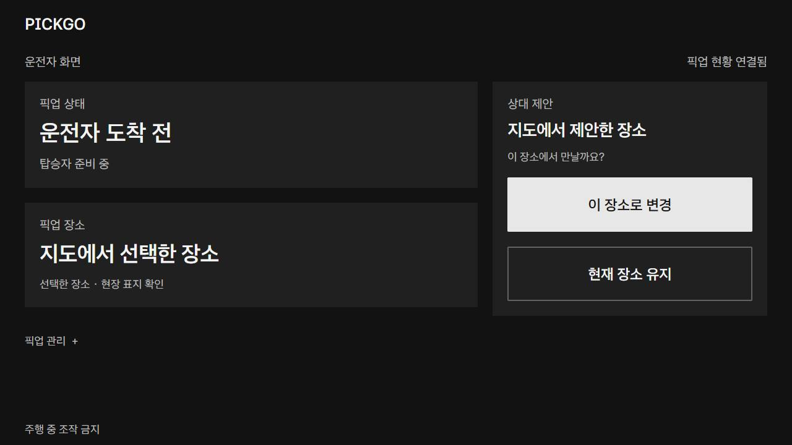

# PICKGO 독립 디자인 검토 보고서

2026-11-06 KST · 검토자 Codex · 기준: 제공된 시연 원본과 현재 작업 트리(main)

단일 픽업은 큰 행동 버튼과 짧은 상태 문구 덕분에 흐름을 따라가기 쉽다. 반면 다인 픽업은 추가 폼·순서·사람 목록을 동시에 보여 주어 현재 누구를 기다리는지 파악하는 부담이 커진다. 우선 개선 대상은 장소 식별, 모바일 다인 행동 배치, 공동 승차 대기 설명, 다인 진행 화면의 정보 순서, 단일 탑승 후 완료 행동이다. 관찰 범위에서 핵심 흐름 실패를 입증하지 못했으므로 P1은 부여하지 않았다.

사용자 후속 지시 “지도 핀에 좌표값이 보이는 부분 수정해야해”에 따라 DR-01의 좌표 표시만 수정했다. 나머지 개선안은 제안이며 구현하지 않았다. 원본 README·스크린샷·영상은 당시 증거로 보존한다. 따라서 아래 원본 이미지에는 수정 전 좌표가 남아 있다.

## 검토 방법과 범위

- AGENTS.md, DEVELOPMENT_GUIDE.md 전체, README, FILE_OWNERSHIP, 결정·API·작업·시험 기록의 최신 관련 항목, DOTS_COLLABORATION, 두 UI 정리 문서, USER_GUIDE, DEMO_SCRIPT, VERIFICATION, VIDEO_INFO, SRT를 확인했다.
- 실제 PNG 22장과 소개 배치 JPG 1장을 6개 모음 이미지로 직접 시각 검토했다. 다인 모바일·다인 준비·위치 동의·단일 완료 화면은 개별 원본으로도 확인했다. 확대 증거는 원본 크롭을 2배로 확대한 것으로, 개선 UI를 합성한 것이 아니다.
- 영상은 플레이어에서 연속 재생한 것이 아니다. 로컬 FFmpeg로 **35개 시각의 프레임**을 추출해 9개 모음으로 직접 확인했다. 00:00, 00:05, 00:06, 00:08부터 01:36까지 4초 간격, 01:39, 01:42, 01:46, 01:50, 01:54, 01:58, 01:59, 02:02, 02:05. 각 설명 구간의 상태와 주요 전환을 점검했으며 프레임 사이의 클릭·짧은 팝업·반응 속도는 평가하지 않았다.
- 제공 파일의 SHA256·크기: [source-manifest.json](evidence/pickgo-design-review-2026-11-06/source-manifest.json). 영상 해시 `96ec9e603c61e9fd4143179eeaa9dbdc899597c342f12e15c0d44591b4964e74`.
- 1280×720 단일 가로 화면, 390×844 탑승자 화면을 검토했다. 09는 390×1354, 18은 1280×1799, 19는 1280×1568, 21·22는 1280×1100이다. 확장 촬영본을 실제 휴대폰/차량 한 화면이라고 판단하지 않았다. 다인 휴대폰 가로·200% 확대·6명 최대 상태·스크린리더·실차 대비·물리폰은 미검토다.
- 출처의 웹259시험 및 내비 검증은 기능 증거이며 디자인 사용성 시험은 아니다. 본 검토는 관찰 기반 전문가 검토이며 실제 사용자 실수율·소요시간을 측정하지 않았다. 공식 심사 배점이나 실차 안전 적합성을 판정하지 않는다.

## 잘된 점과 점검 요약

검정·차콜 바탕, 큰 흰색 주 행동, 윤곽선 보조 행동은 단일 픽업에서 일관적이다. 홈의 여백은 검색에 집중시키는 의도와 맞으며, 빈 공간 자체를 결함으로 세지 않았다. 단일 화면은 운전자/탑승자 역할을 텍스트로 구분하고, 장소 확정은 체크와 문구를 함께 써 색만으로 상태를 전달하지 않는다. 제안 중에는 기존 장소와 상대 제안을 분리하고 수락/유지를 나란히 제공한다. 도착·탑승을 수동 확인하는 문구와 지도 출처·현장 표지 확인 안내도 유지되어 있다.

| 점검 영역 | 관찰 및 판단 |
|---|---|
| 첫인상·시각적 위계 | 단일은 명확. 다인은 진행보다 추가 폼이 우선(DR-04) |
| 정보 밀도·여백 | 단일 여백은 유지 가치. 다인 전체 축소는 영상에서 특히 불리(MD-01) |
| 가독성·대비 | 주요 흰색 글자는 식별 가능. 다인 버튼 줄바꿈과 비활성 설명 부족(DR-02/03). 정량 대비 적합성은 미측정 |
| 주/보조 행동 | 단일 기본 흐름 양호. 완료 행동 발견성(DR-05), 다인 취소가 준비 버튼과 같은 줄(DR-02) |
| 역할·합의·상태 | 역할 표시와 합의 구분 양호. 단일 초대 화면은 장소 정보가 없음(DR-06) |
| 지도·좌표 | 배경 지도/출처 양호. 좌표형 장소명(DR-01), 후보 구별 단서 부족(DR-07) |
| 모바일·가로 | 단일 가로는 핵심 상태/행동 유지. 다인 390px 버튼은 개선 필요. 모바일 가로는 미확인 |
| 다인·공동 승차·스크롤 | 공동 지점 잠금 자체는 의도된 기능. 남은 사람과 잠금 이유의 연결이 약함(DR-03/04) |
| 동의 화면 | 보관·삭제 제약 명시 장점. 거부 행동까지 긴 읽기 경로(DR-08) |

## 문제별 근거와 최소 개선안

P2는 관찰된 조건의 사용성 문제, P3는 흐름을 막지 않는 개선 제안이다. 사용자 영향은 관찰에서 도출한 위험이며 실사용에서 발생했다고 주장하지 않는다.

### DR-01 · P2 · 좌표 문자열이 장소명을 대신함 — 표시 수정 완료, 장소 식별 보강은 남음

- 화면/역할: 단일 운전자·탑승자, 장소 변경, 위치 공유.
- 근거: [07-ready-driver.png](showcase/screenshots/07-ready-driver.png), [08-ready-rider.png](showcase/screenshots/08-ready-rider.png), [10-change-place.png](showcase/screenshots/10-change-place.png), [09-location-consent.png](showcase/screenshots/09-location-consent.png). 영상 00:24·00:32·00:40.
- 실제 관찰: `지도 핀 (37.4639150, 127.0351004)`가 큰 장소 제목이며 모바일에서는 두 줄을 차지한다. 픽업 장소의 도로명이나 출입구를 알 수 없다.
- 영향: 숫자를 읽어도 실제 만날 지점을 이해하기 어렵고, 잘못된 장소 합의를 알아채기 어렵다.
- 원인: map/board.mjs의 좌표형 canonical place를 app/phone 등의 UI에 그대로 출력한다. `선택한 장소` 보조문구만 바꿔서는 큰 제목의 좌표가 사라지지 않는다.
- 최소 개선 및 이번 반영: 공통 표시 함수로 `지도에서 선택한 장소` / `지도에서 제안한 장소`를 사용하고 API place/mapPoint는 유지. 근거 없는 실제 도로명·출입구를 만들어 넣지 않는다. 후속으로 검증된 장소명이나 작은 지도 미리보기를 제공하면 서로 다른 핀의 구별이 좋아진다. 이번 범위에서 역지오코딩은 추가하지 않았다.
- 재검증: 양 역할의 기본·제안·변경·위치 화면에서 좌표 텍스트가 안 보이고, 수락 후 mapPoint 및 canonical place가 원래 좌표를 유지해야 한다. 연결 만료 표시·기존 일반 장소명도 보존해야 한다.

### DR-02 · P2 · 다인 모바일에서 네 행동을 한 줄에 압축

- 화면/역할: 다인 탑승자, 390×844.
- 근거: [20-multi-rider.png](showcase/screenshots/20-multi-rider.png), 영상 01:08·01:16.
- 실제 관찰: `아직 / 준비 / 중`, `내 / 픽업 / 취소`처럼 세 줄로 꺾인다. 비활성 탑승 버튼은 좁은 영역에서 흐릿하게 보인다. 아래에는 충분한 빈 공간이 있다. 단일 준비 버튼과 달리 다인 준비 버튼은 현재 선택의 시각적 구별도 약하다.
- 영향: 준비 변경·탑승·취소를 빠르게 구별하기 어렵다. 실제 오터치는 미측정.
- 원인 가설: `.actions button{flex:1}`과 한 줄 내 네 버튼의 최소 너비/줄바꿈 정책.
- 최소 개선: 준비 선택은 2열, 도착 후 탑승 행동은 별도 전체 너비, 취소는 하단 보조 행동으로 분리. 선택된 준비 상태를 단일 화면과 같은 방식으로 표시. 큰 터치 영역과 확인 대화상자는 유지.
- 재검증: 320·390·430px에서 버튼 문구가 1~2줄 안에 읽히고 준비/도착/탑승/취소 상태 모두에서 주 행동이 구별되는지 확인. 키보드·200% 확대도 추가 확인.

### DR-03 · P2 · 공동 승차에서 ‘누구를 기다리는가’와 잠금 이유가 떨어져 있음

- 화면/역할: 다인 운전자.
- 근거: [21-shared-stop.png](showcase/screenshots/21-shared-stop.png), 영상 01:28.
- 실제 관찰: 왼쪽은 `남은 지점 1곳`, 도착 지점, 비활성 다음 지점 버튼을 표시한다. 오른쪽은 A/B 탑승 완료, C 준비 완료다. `C의 탑승 확인 대기` 또는 `현재 지점 1/2명 탑승` 요약은 없다.
- 영향: 준비 완료와 탑승 완료의 차이를 목록에서 대조해야 다음 버튼의 비활성 이유를 이해한다. 공동 승차의 남은 사람을 확인하려면 두 목록을 대조해야 한다. 영상에서의 자막 의존은 MD-01과 구분한다.
- 원인 가설: 경유 순서와 사람 상태를 별도 목록으로 렌더링하며 활성 지점의 요약을 만들지 않음.
- 최소 개선: 현재 지점 아래 `2명 중 1명 탑승 · 동행 C 확인 대기` 한 줄 추가. 비활성 다음 행동 옆에 같은 이유를 표시. 자동 취소/자동 진행으로 해결하지 않는다.
- 재검증: 공동 2명 중 0/1/2명 탑승, 일부 취소, 준비 중인 사람 존재 조건에서 남은 사람과 진행 조건이 일치해야 한다.

### DR-04 · P3 · 다인 진행 화면 상단을 추가 폼이 계속 차지함

- 화면/역할: 다인 운전자 가로 화면.
- 근거: [19-multi-ready.png](showcase/screenshots/19-multi-ready.png), [21-shared-stop.png](showcase/screenshots/21-shared-stop.png), 영상 01:08~01:32 추출 프레임.
- 실제 관찰: 19번 확장 원본에서 추가 폼이 y239~658, 순서/사람 패널은 약 y706부터 시작한다. 이미 3명이 준비했어도 추가 폼이 우선이다. 21번에는 추가 불가 상태의 폼까지 남는다.
- 영향: 보통 높이의 가로 화면에서는 현재 픽업 지점/사람/다음 행동을 보려면 스크롤이 필요할 가능성이 높다. 확장 촬영본만으로 실제 모든 viewport의 위치를 확정하지는 않는다.
- 원인 가설: 설정 단계와 운행 진행 단계를 같은 문서 순서로 유지.
- 최소 개선: 초대 완료 후 추가 폼을 명시적인 `탑승자 추가` 펼침으로 접고, 현재 지점·미탑승 인원·다음 행동을 먼저 배치. 목록 전체를 억지로 한 화면에 줄이지 말고 이미 완료한 사람은 별도 펼침으로 분리.
- 재검증: 1280×720·1024×600, 3명/6명에서 현재 지점과 주 행동이 첫 화면에 보이는지, 스크롤 후 상태 변화에도 초점과 사용자가 보는 위치가 보존되는지 확인.

### DR-05 · P2 · 탑승 후 완료를 요청하지만 주 행동 자리에는 버튼이 없음

- 화면/역할: 단일 운전자.
- 근거: [15-boarded.png](showcase/screenshots/15-boarded.png), 영상 00:52.
- 실제 관찰: 오른쪽 넓은 행동 패널에는 `모두 탔다면 픽업을 종료하세요.`만 있고, `픽업 관리 +`는 접혀 있다. 완료 행동은 관리 메뉴를 열어야 찾는다. 16번은 이미 완료된 상태이므로 이 문제의 직접 근거와 구분한다.
- 영향: 탑승 완료와 회차 완료 사이에서 다음 조작이 불명확하다. 실제 완료 불가능 문제는 아니며 영상은 최종 완료에 도달한다.
- 원인 가설: 보조 조작을 관리 메뉴로 모으는 규칙이 단계 전환 후의 주 행동에도 적용됨.
- 최소 개선: 탑승 확인 후에만 주 행동 자리로 `픽업 완료`를 노출하고 기존 확인 단계를 유지. 사용자 요청인 평상시 간결한 화면은 그대로 유지.
- 재검증: 탑승 전에는 완료로 오인할 버튼이 없고, 탑승 후 관리 메뉴를 열지 않아도 완료 행동을 찾으며, 확인 취소·탑승 철회·오래된 상태에서는 기존 제한이 유지되어야 한다.

### DR-06 · P3 · 초대 참여 전에 확인할 장소 정보가 부족

- 화면/역할: 단일 초대받은 탑승자.
- 근거: [06-rider-invitation.png](showcase/screenshots/06-rider-invitation.png), 영상 00:28.
- 실제 관찰: `픽업 초대가 왔습니다`, 위치 공유 안내, 참여/닫기만 보이며 장소는 없다. 위에는 단일 초대와 무관한 `여러 명 함께 픽업` 링크가 남아 있다.
- 영향: 초대의 맥락을 확인하기 전에 참여해야 하며 다른 흐름으로 이탈할 여지가 있다. 초대 보안 실패를 관찰한 것은 아니다.
- 원인 가설: 일반 홈 진입 구조를 재사용하면서 초대 문맥을 충분히 분리하지 않음.
- 최소 개선: 공개 가능한 초대 미리보기 범위에서 픽업 장소와 참여 역할을 간단히 표시하고, 단일 초대에서는 다인 진입 링크를 접는다. 개인 식별정보를 새로 노출하는 설계는 별도 검토.
- 재검증: 정상·만료·이미 사용된 초대에서 장소 공개 정책을 지키며 올바른 회차 참여/닫기를 구별할 수 있어야 한다.

### DR-07 · P3 · 장소 후보가 같은 도로명과 근소한 거리 차이로만 구별됨

- 화면/역할: 단일 운전자 검색 후 선택, 다인 지점 선택.
- 근거: [03-candidates.png](showcase/screenshots/03-candidates.png), [17-multi-setup.png](showcase/screenshots/17-multi-setup.png), 영상 00:16·01:00.
- 실제 관찰: 세 후보가 모두 `매헌로6길`이며 직선 723/759/760m로만 구별된다. 다인에서는 `장소 1/2` 번호가 붙지만 현장 단서는 없다. 지도 선택 대안은 존재한다.
- 영향: 759m와 760m의 지점 차이를 텍스트만으로 판단하기 어렵다. 거리의 기준점도 행 자체만으로 분명하지 않다.
- 원인 가설: 도로 데이터에서 추출한 후보 이름과 번호를 사용자용 지점 설명으로 그대로 사용.
- 최소 개선: 실제 데이터로 확인 가능한 도로 구간/가까운 시설을 보조 라벨로 제공하거나 후보 번호와 연결된 작은 지도 표시. 거리는 `검색 장소에서 직선 …m`로 기준만 짧게 보강. 출입구·정차 허용을 추정하지 않음.
- 재검증: 같은 도로명 후보 3개를 선택했을 때 번호·지도 핀·확정 지점이 일치하고, 좌표를 읽지 않아도 지점 차이를 확인할 수 있어야 한다.

### DR-08 · P3 · 위치 공유 동의 화면에서 거부와 현재 상태가 긴 본문 아래에 있음

- 화면/역할: 단일 탑승자, 위치 공유 선택.
- 근거: [09-location-consent.png](showcase/screenshots/09-location-consent.png), 영상 00:36.
- 실제 관찰: 원본 1354px 높이에서 동의 버튼은 y728 부근, 거부 버튼은 y881 부근, 현재 미수집 상태는 그 아래다. 844px 높이에서는 거부 버튼까지 스크롤해야 하는 배치다. 긴 본문은 중요한 삭제/단절 제약도 포함한다.
- 영향: 선택 기능임에도 거부와 미수집 상태를 늦게 발견한다. 동의가 강제된다고 단정하지 않는다.
- 원인 가설: 목적·보관·삭제·예외·사용법을 하나의 본문 흐름으로 배치.
- 최소 개선: 목적/받는 사람/일회 공유/보관 핵심/거부해도 이용 가능을 짧은 요약으로 먼저 제공하고 동의·거부를 가까이 배치. 필수 고지와 단절 시 삭제 제약은 삭제하지 말고 읽을 수 있는 상세로 유지. 공유하지 않은 초기 상태에서 중지 버튼의 필요성도 재검토.
- 재검증: 390×667·844에서 수집 전 상태와 동의/거부를 쉽게 찾고, 거부/중지/연결 단절의 동작과 설명이 일치해야 한다. 법적 적합성 심사는 수행하지 않음.

## 영상·촬영 문제 — 앱 결함과 분리

### MD-01 · P2 · 다인 구간의 축소와 이전 회차 화면이 설명을 약화

- 근거: PNG [19-multi-ready.png](showcase/screenshots/19-multi-ready.png)와 영상 추출 [01:04](evidence/pickgo-design-review-2026-11-06/video-064.jpg), [01:28](evidence/pickgo-design-review-2026-11-06/video-088.jpg).
- 관찰: 다인 구간은 긴 운전자 화면을 작게 배치해 이름·준비/탑승 상태가 단일 구간보다 작다. 01:00·01:04의 오른쪽은 이전 단일 회차의 완료 화면이고, 01:08부터 다인 탑승자로 바뀐다. 두 화면이 같은 회차라는 인상을 줄 수 있다.
- 영향: 공동 승차 상태가 이 앱의 차별점인데 시청자는 자막을 읽어야 의미를 따라가기 쉽다. 앱 글꼴 자체가 항상 작다는 증거는 아니다.
- 원인 가설: 고정된 운전자/탑승자 2열 영상 템플릿과 확장 높이 캡처의 축소.
- 최소 개선: 핵심 상태 변화 때 해당 실제 영역을 확대하고, 다인 초대 전에는 오른쪽을 `참여 전` 설명으로 전환하거나 이전 회차임을 표시. B 탑승/C 대기를 잠시 크게 보여 준 뒤 전체 화면으로 복귀. 가짜 동작·UI를 만들지 않는다.
- 재검증: 1080p와 축소 재생에서 현재 사람/지점/남은 사람을 읽을 수 있는지 별도 시청자 확인. 편집된 상태와 실제 캡처의 대응을 유지.

01:39~01:42는 별도 촬영·동일 빌드 아님을 명시하며 01:46 이후 실제 에뮬레이터로 전환한다. 이 차이는 최신 앱의 디자인 불일치로 세지 않았다. 저빈도 캡처 편집본이므로 버벅임·지연·애니메이션 품질을 판정하지 않았다. 지도 타일의 외부 의존성, 실차·CarUxRestrictions·실제 도로시간·다중 경유 미완료는 제품 준비도 제한이며 본 보고서의 시각 결함 수에 포함하지 않았다. 숨긴 합성 설정도 일반 사용자 기능으로 평가하지 않았다.

## 우선 개선 5개와 순서

1. **DR-01 좌표 표시 제거**: 이번 사용자 승인으로 반영. 다음 단계는 실제 근거가 있는 지점 식별 보강.
2. **DR-02 다인 모바일 버튼 배치**: 실제 원본에서 확인되는 좁은 버튼 문제부터 해결.
3. **DR-03 공동 지점 대기 요약**: 누가 남았는지와 다음 진행 조건을 한곳에 표시.
4. **DR-04 진행 화면 재배치**: 추가 폼을 접고 현재 지점과 주요 행동 우선.
5. **DR-05 탑승 후 완료 행동 노출**: 상태별 주 행동의 연속성 확보.

그 뒤 DR-07 후보 구별, DR-06 초대 문맥, DR-08 동의 정보 순서를 검토한다. MD-01 영상 편집은 앱 개선과 별도로 진행 가능하다. 공모전 시연에서는 첫째로 ‘장소를 정한다’, 둘째로 ‘누가 남았는지 안다’, 셋째로 ‘다음 행동이 명확하다’가 화면만으로 드러나는 것이 중요하다. 이는 전달력에 대한 판단이며 공식 배점·수상 가능성 추정이 아니다.

## 수정·실행·검수 기록

- 수정 범위: 사용자 승인된 DR-01만. `place-label.mjs` 추가, app/phone-page/proximity-page/recommendation/page의 장소 표시 적용, server의 정적 모듈 경로 추가. API/도메인/지도 좌표/Android 소스 불변. 기존 변경 전 사본은 전용 evidence/before-fix에 보존.
- 기존 fake DOM 시험은 import 없는 스크립트를 VM으로 평가해 신규 import 도입 후 40건이 실행 단계에서 실패했다(219/259). 6개 시험 harness가 실제 formatter 소스를 로드하도록 수정했으며 fake formatter로 대체하거나 assertion을 제거하지 않았다.
- 재실행 `node --test "experiments/pickup-board/*.test.mjs"`: **260/260 통과**(기존259 + 좌표/제안/stale 보존 회귀1), [tests-final.log](evidence/pickgo-design-review-2026-11-06/tests-final.log). 첫 실패는 [tests.log](evidence/pickgo-design-review-2026-11-06/tests.log)에 보존.
- 시각 검토/프레임 추출: `python docs/evidence/pickgo-design-review-2026-11-06/extract.py`, 크롭 생성 `crops.py`, 종료0. 원본 소스 해시 재검증 대상.
- 실제 Chrome 표시·좌표 보존 검증: 전용 임시 loopback 서버와 독립 브라우저, [verify-fix.mjs](evidence/pickgo-design-review-2026-11-06/verify-fix.mjs), [browser.log](evidence/pickgo-design-review-2026-11-06/browser.log). 결과 및 독립 검수는 아래 최종 기록 참조.
- 앱 전반 디자인 개선·원본 영상 재편집·APK 재빌드·실차·외부 제출·push는 미실행. J-1 재개 없음. Dot R010 종료 기록 확인, 새 공식 조사 질문이 없어 신규 과제 없음.

### 브라우저 검증과 수정 후 화면

`node docs/evidence/pickgo-design-review-2026-11-06/verify-fix.mjs` 종료0. 실제 Chrome에서 단일 운전자/탑승자 장소명, 변경 화면의 현재 장소, 위치 공유 문맥, 지도 좌표 제안 표시, 수락 후 canonical place와 mapPoint 보존을 assertion으로 확인했다. 근접/추천 보조 화면에서도 좌표 문자열 비노출을 확인했다. 새 driver/rider/proposal/phone 캡처 4장을 직접 시각 검토했다. 내비 실제 호출은 재실행하지 않았으므로 내비 연동 재검증 완료로 확대하지 않는다.

원본 미디어 24개(22 PNG, 소개 JPG, MP4)의 SHA256 재검사에서 변경0. 보고서 상대 링크는 1차 23개 누락0이며 최종 추가 링크도 다시 검사한다. `git diff --check` 종료0(기존 파일의 LF/CRLF 안내만 존재). 기존 소스의 변경 전 사본과 이번 수정만의 [fix.diff](evidence/pickgo-design-review-2026-11-06/fix.diff)를 보존했다. 이번 소스 변경은 좌표 표시 제거에 한하며 나머지 디자인 문제는 열린 제안이다.

### Claude 독립 검수 및 지적 처리

실제 Claude Haiku 5.5, session `bd18ea16-f14f-4d2f-b26b-e41beb7b4150`, exit0 / is_error=false. [고정 입력](evidence/pickgo-design-review-2026-11-06/review-input.txt)·[manifest](evidence/pickgo-design-review-2026-11-06/review-manifest.json)·[회신](evidence/pickgo-design-review-2026-11-06/review.json). 이미지 자체는 전달하지 않았으며 Claude는 보고서 텍스트/고정 diff 검수만 수행했다. 실제 시각 검토 주체는 Codex다.

- 표시 수정의 상태·권한·좌표 불변 판단: 수용. 실제 Chrome의 수락 후 좌표 assertion과 일치.
- map/multi/Android 누락 가능성: [표시 경로 검색](evidence/pickgo-design-review-2026-11-06/display-sweep.txt)으로 확인. map은 좌표를 마커 위치로만 쓰고, multi는 stop.label을 표시한다(검토 PNG는 도로명·장소번호). Android는 원격 웹 화면과 별도 고정 버튼/상태 문구를 사용한다. 앱 전체 저장소의 모든 속성/빌드 변형을 실행 검증한 것은 아니며 기존 설치 APK의 화면 재검증은 남는다.
- 소수 7자리 제한: map/board.mjs가 toFixed(7)로 생성하고 decodePoint도 같은 형식만 해석하므로 현행 계약에 맞는 표시다. 임의 사용자 문자열이나 숫자 전체를 숨기는 광범위 치환으로 확장하지 않았다. API 계약 변경 시 formatter도 함께 검토해야 한다.
- 일반 장소/stale 보존 증거: 기존 일반 장소·연결 실패 회귀에 더해 좌표 현재/제안/stale 상태의 표시 및 원본 상태 보존 시험1건을 추가, 최종260/260 통과.
- 수정 후 시각 증거 부족: 검수 중 병행한 실제 Chrome 캡처4장 직접 확인과 위 이미지로 해소.
- 수락 후 두 핀의 라벨이 같아지는 문제: 수용. 좌표 제거만 완료이며 검증된 장소명/지도 미리보기 보강은 DR-01의 열린 개선으로 명시. 바뀐 실제 지점은 지도에서 확인해야 한다.
- DR-04·DR-07 심각도: P3로 낮춤. 실제 viewport 추가 측정 및 후보 선택 사용성 근거 확보 후 재평가.
- DR-05 P3 하향 제안: 미반영. 완료 불가능은 P1 근거가 될 수 있으나 본 지적은 탑승 후 필수 다음 행동이 주 행동 영역에 없고 접힌 메뉴에 있는 제한 조건의 발견성 문제이므로 P2 유지. 정상 완료 가능함을 명시했다.
- DR-03 자막 영향: 앱의 목록 대조 문제와 영상 전달력 문제를 분리하도록 문구 보완.
- DR-02 선택 구별: 원본390px과 확대를 직접 확인했으므로 관찰을 유지하되 대비 규격 미달로 주장하지 않는다.
- MD-01 P2가 앱/영상 분리와 충돌한다는 의견: 미반영. 별도 MD ID·별도 절·편집 원인·영상 재검증 기준으로 분리하며 P2는 영상 전달력 개선 우선순위다.

다음 구현 담당자는 사용자 승인 후 DR-02부터 진행한다. 이번 검토의 다른 개선안을 자동 승인으로 해석하지 않는다. main의 기존 미커밋은 보존했으며 보고서/증거·좌표 표시 수정의 소유를 반환한다.
