# PICKGO 사용 설명서

- 목적: 운전자와 탑승자가 만날 장소·준비·도착·탑승 상태를 같은 픽업 회차에서 확인.
- 기준: 2026-11-06 로컬 웹 프로토타입. 좌표 표시·모바일 레이아웃·초대 안내 개선 후 화면으로 새로 촬영.
- 화면: 실제 Chrome 실행 캡처. 가상 인물만 사용. 휴대폰 모양 화면은 모바일 크기의 브라우저이며 물리 휴대폰 검증 자료가 아님.
- 조작: 주차 등 조작 가능한 상황에서만 시연. 현재 앱은 차량 주행 제한 연동을 완료한 배포본이 아님.
- 바로가기: [화면 중심 README](../../README.md) · [시연 영상](video/PICKGO_DEMO.mp4) · [시연 대본](DEMO_SCRIPT.md).

## 1. 시작하기

- Node.js 22 이상 설치.
- 저장소 루트에서 `npm start` 실행.
- 같은 컴퓨터의 브라우저에서 `http://127.0.0.1:4180` 열기.
- 운전자 화면과 탑승자 화면을 별도 탭으로 사용.
- 기본 주소는 같은 컴퓨터 전용. 링크를 다른 휴대폰으로 보내는 것만으로 접속되지 않음.
- 서버는 메모리 저장 방식. 재시작하면 회차가 사라짐.

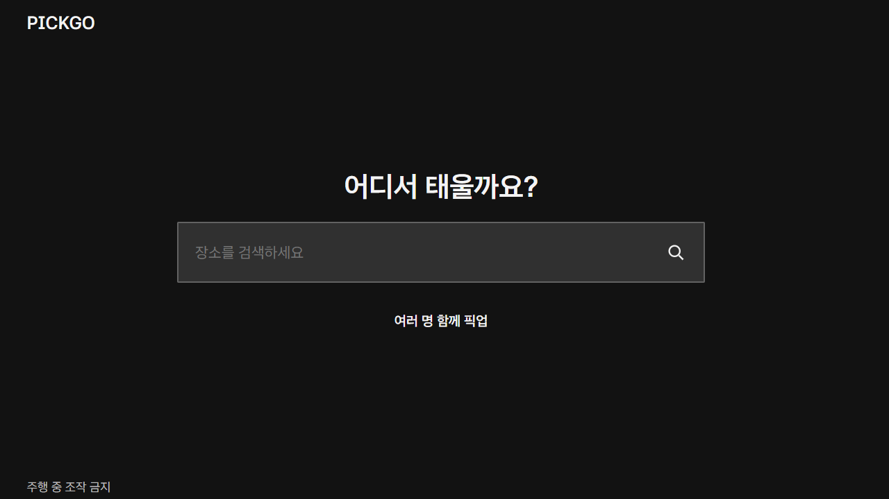

## 2. 한 명 픽업하기

### 장소 검색·선택

- 검색창에 장소 이름 입력 → 검색 버튼.
- 검색 결과 선택 → 주변 픽업 후보 확인.
- 후보 선택 → 픽업 시작 버튼.
- 현재 양재 주변에 수록된 OSM 장소·도로·주소 검색 지원.
- 전국 실시간 POI 검색 또는 실제 차량 현재 위치 검색은 미지원.
- 예시 검색어: `하나로마트`.

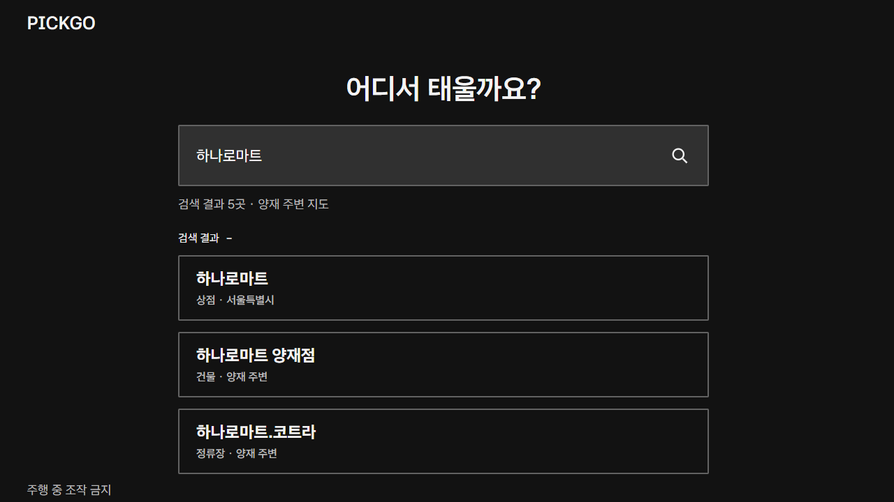
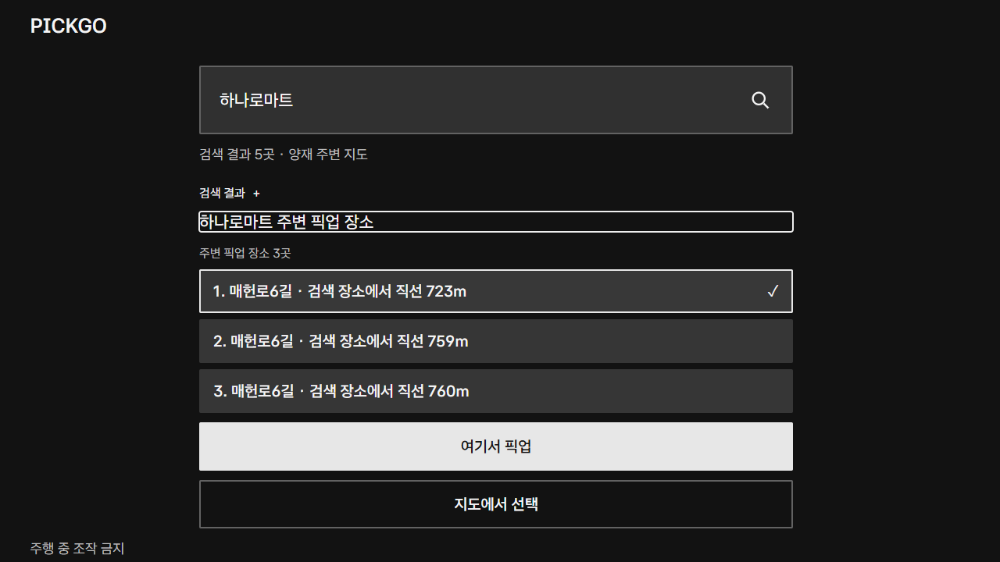

### 지도에서 직접 선택

- 검색 결과를 고른 뒤 `지도에서 선택` 열기.
- 지도 클릭 또는 `주변 장소·지도 설정`의 후보 선택.
- 선택 결과 확인 → `여기서 픽업`.
- 이미 참여한 회차라면 새 지점은 장소 변경 제안으로 처리.
- 지도 확대·축소, 검색 장소로 이동, 차단 영역 표시 전환 제공.
- 데이터에서 판별한 버스정류장·횡단보도 주변, 건물 내부, 고속도로·전용 차로 등 일부 영역 차단.
- 선택 가능 표시는 합법 정차 인증이 아님. 미수록 표지·시간대 통제 등이 있을 수 있으므로 현장 확인 필요.
- 지도 데이터는 유효기간 검사 대상. 만료 시 갱신 필요 안내.

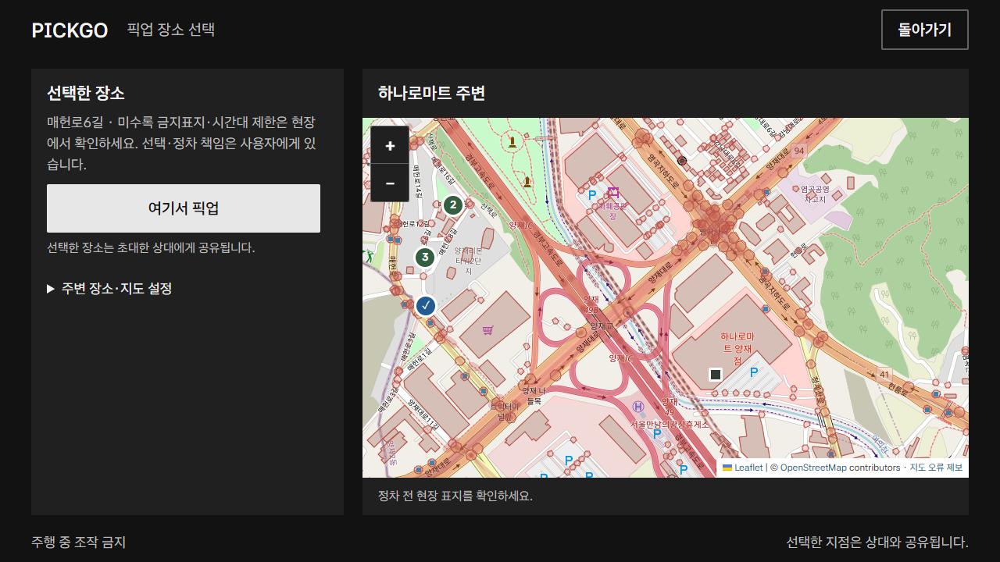

### 초대·참여·준비

- 운전자: `초대 링크 복사` → 원하는 연락 수단으로 직접 전달.
- 같은 PC 시연: `초대 링크 열기`로 탑승자 탭 열기.
- 탑승자: `탑승자로 참여` → `준비 완료` 또는 `준비 중` 선택.
- 상대 참여 후, 진행 중이며 변경 제안이 없고 최신 상태가 확인되면 장소 확정 표시.
- 초대 링크 복사는 메시지 자동 전송 기능이 아님.
- 새로고침 시 같은 탭의 참여 정보 복원 지원. 탭을 닫거나 다른 브라우저로 이동하면 복원이 보장되지 않음.

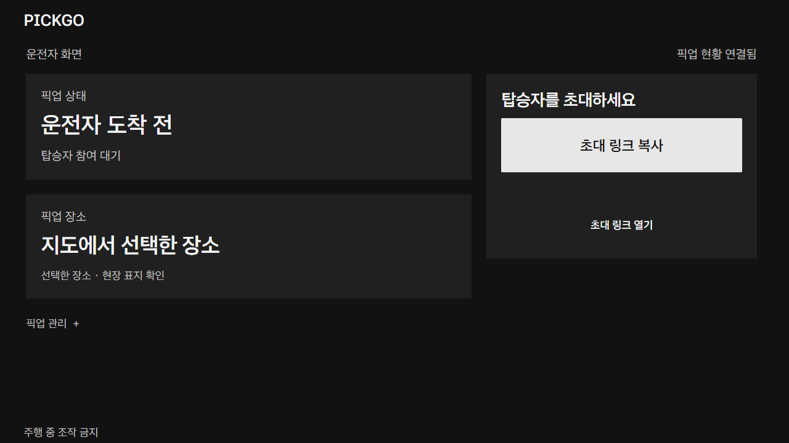

| 탑승자 초대 | 준비 완료 |
|---|---|
| 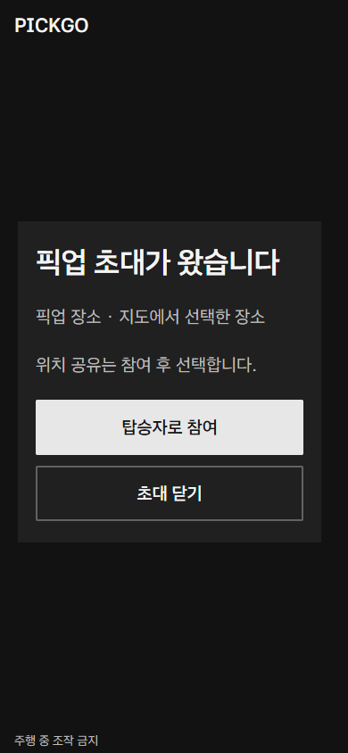 | 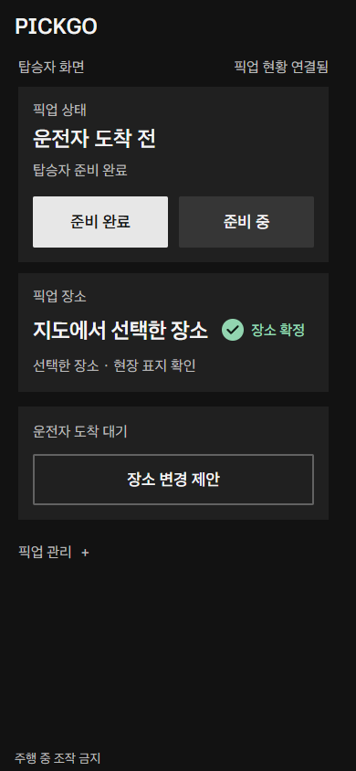 |

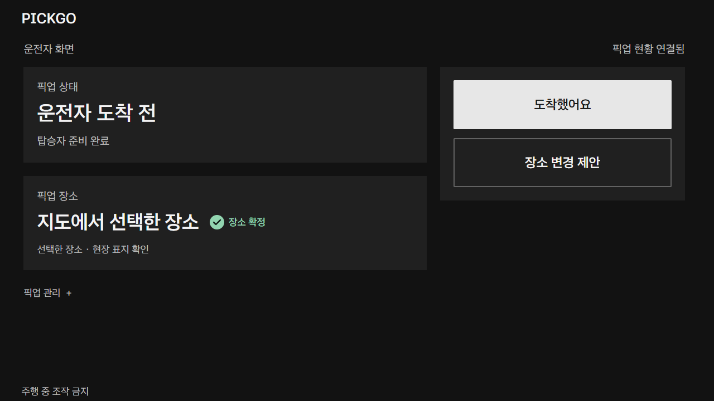

### 장소 변경·수락·거절·철회

- 운전자 또는 탑승자: `장소 변경 제안` → 다른 장소 선택.
- 상대: `이 장소로 변경`으로 수락 / `현재 장소 유지`로 거절.
- 제안자: 상대가 결정하기 전에 `제안 철회` 가능.
- 상대 수락 전까지 기존 확정 장소 유지.
- 수락 시 새 장소로 변경. 기존 도착 표시와 위치 공유 등 관련 상태는 새 장소 기준으로 재확인.
- 지도에서 선택한 지점과 고정 목록의 장소 변경은 구별. 고정 목록의 이름만으로 내비 전달용 확정 좌표가 확보되는 것은 아님.

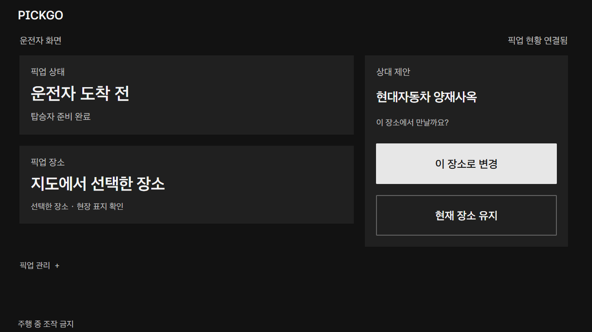
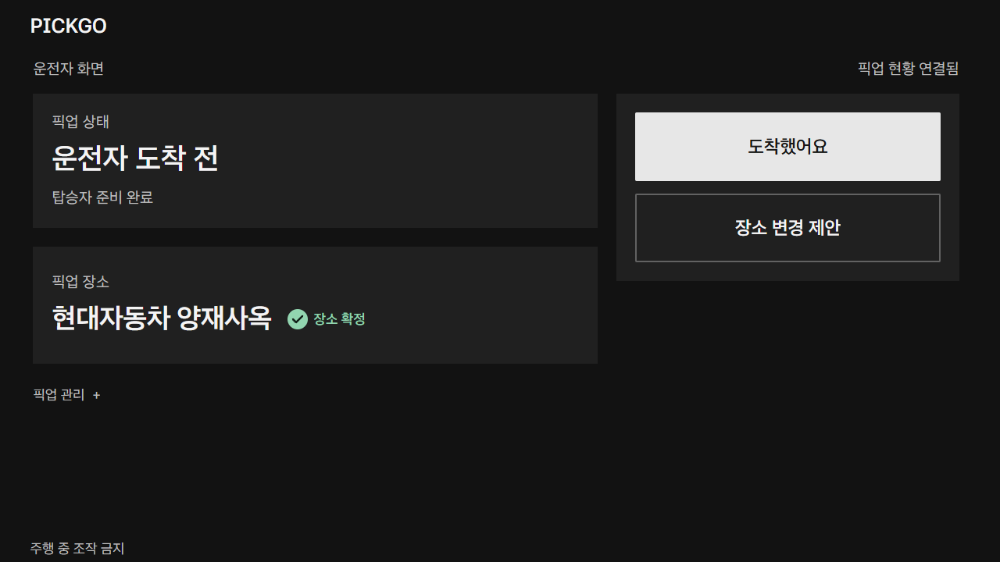

### 도착·탑승·종료

- 운전자: 실제 도착 후 `도착했어요`.
- 탑승자: 실제 탑승 후 `탑승했어요`.
- 잘못 누른 경우 해당 역할의 `도착 표시 취소` / `탑승 확인 취소` 사용.
- 운전자: 탑승 확인 후 `픽업 완료` → 종료 확인.
- 탑승 확인 후 종료는 완료, 탑승 전 종료는 취소로 구분.
- 종료 후 `새 픽업 시작`으로 새 회차 생성.
- `픽업 관리`에서 최근 변경 기록·새로고침·지도·위치 공유 접근.
- 도착·탑승은 수동 확인. GPS 근접만으로 자동 완료하지 않음.

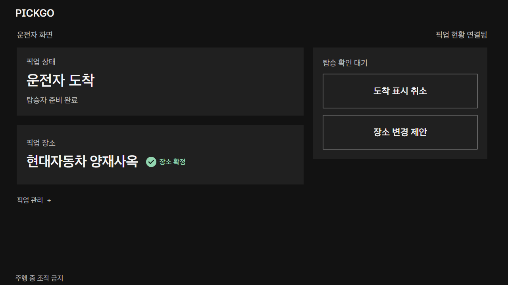
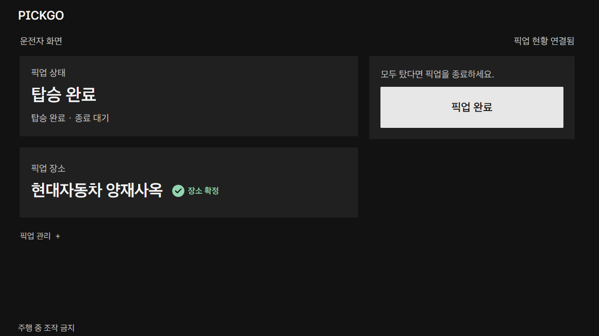
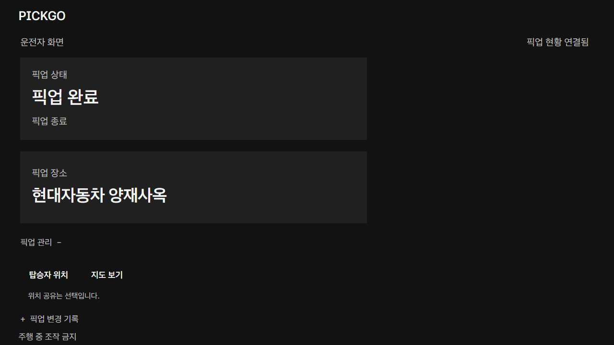

## 3. 휴대폰 위치 공유 선택하기

- 탑승자: 참여한 탭의 `픽업 관리` → `내 위치 공유 · 선택`.
- 운전자 화면에서는 같은 메뉴가 `탑승자 위치`로 표시됨.
- 목적·보관·삭제 안내 확인.
- `동의하고 현재 위치 한 번 공유`: 브라우저 위치 권한을 요청해 일회 공유.
- `동의하지 않음`: 위치를 보내지 않고 기본 픽업 기능 이용.
- `공유 중지 · 위치 삭제`: 서버에 중지·삭제 요청.
- 마지막 위치 1개만 보관. 관측 후 30초에 조회 차단, 다음 정리 주기에 제거.
- 공유 중지·탑승·종료 등 서버가 처리한 삭제 조건에서 제거. 단절 중 삭제 요청 도착은 보장되지 않으며 조회 만료 적용.
- 위치 공유는 도착·탑승 자동 확인에 사용하지 않음.
- 이번 영상은 동의 거부 흐름을 시연. 실제 휴대폰 HTTPS 위치 공유 성공을 증명하지 않음.

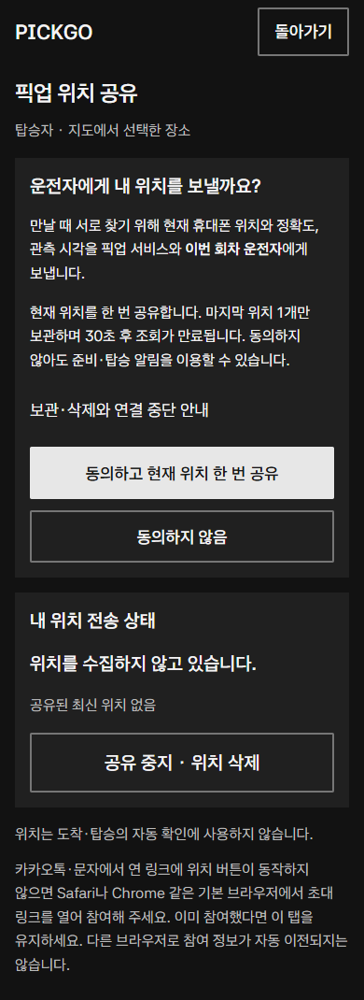

## 4. 여러 명 함께 픽업하기

### 회차·탑승자 추가

- 첫 화면의 `여러 명 함께 픽업` 선택.
- 출발 지점, 선택적 최종 목적지 선택 → `여러 명 픽업 시작`.
- 표시 이름·승차 지점 입력 → `초대 링크 만들기`.
- 사람별 독립 링크 제공. 각자 본인의 링크로 참여.
- 같은 장소에서 함께 탈 경우 `같은 지점 함께 승차` 항목을 명시 선택.
- 가까운 지점을 자동 병합하지 않음.
- 한 회차에 취소한 사람까지 총 6명. 차량 정원은 별도로 준수.
- 초대 후 장소를 바꾸려면 해당 사람을 취소하고 새로 추가. 공동 장소 재합의는 미지원.

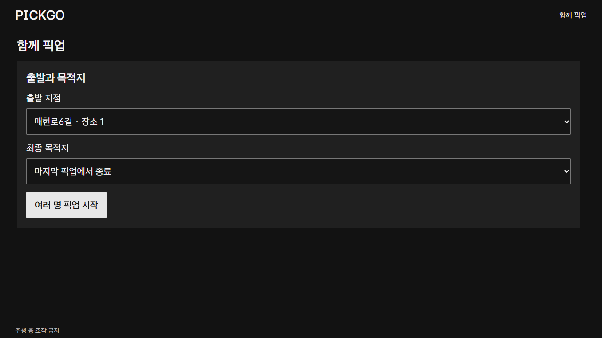
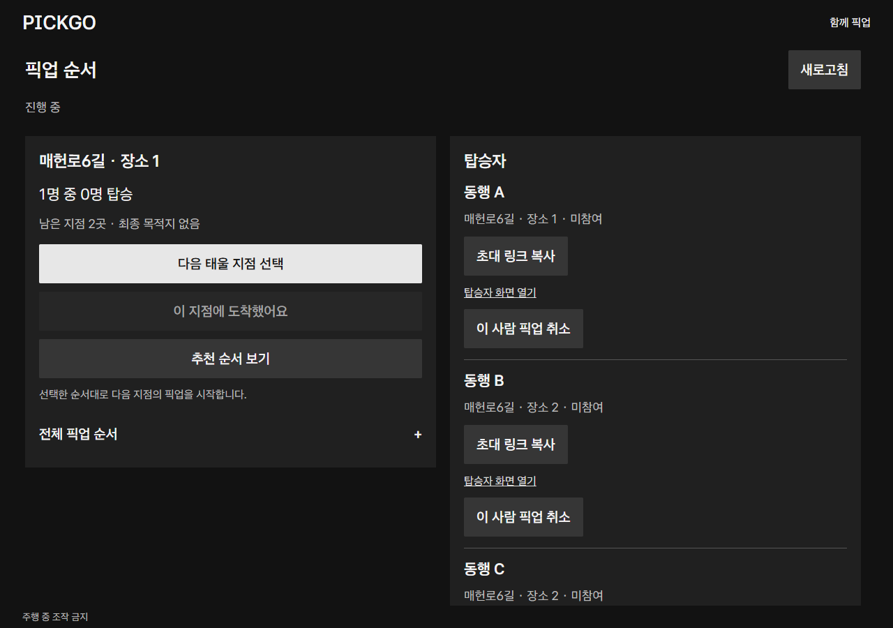

### 순서·준비·탑승

- 운전자: 지점별 위·아래 이동 버튼으로 순서 조정.
- 탑승자: `이 지점으로 참여` → `준비 완료` / `아직 준비 중`.
- 운전자: `다음 태울 지점 선택` → 도착 후 `이 지점에 도착했어요`.
- 현재 지점의 탑승자: 각자 `탑승했어요`.
- 공동 승차 지점은 해당 인원 모두 탑승 또는 명시 취소 후 다음 지점 진행.
- 준비 중인 사람을 임의로 제외하지 않음.
- 다음 지점 선택은 앱 내부 진행 상태 변경. 현대 내비 다중 경유 전송 기능이 아님.

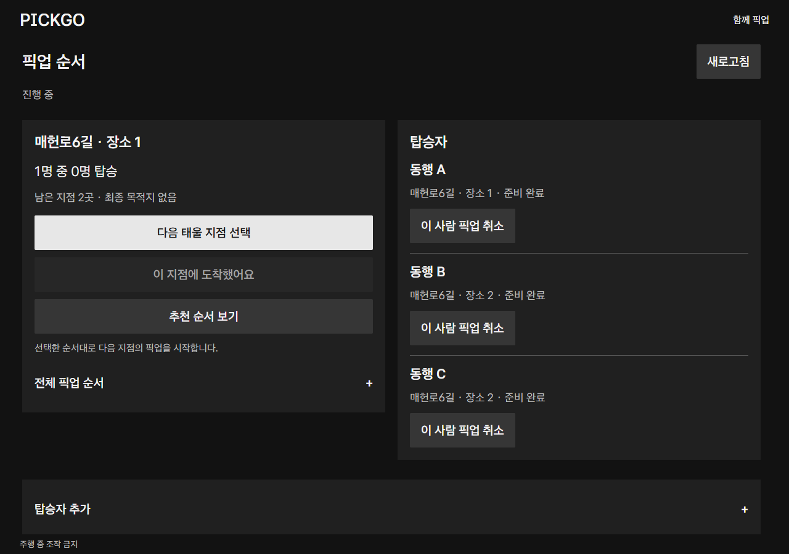
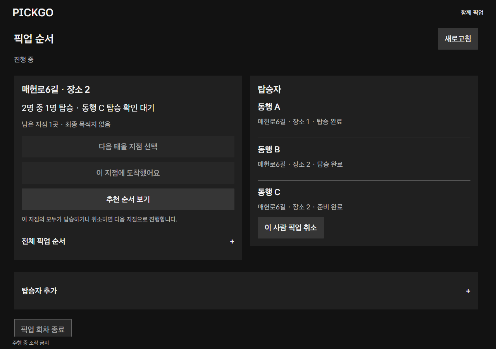

### 취소·종료

- 운전자: 해당 사람의 픽업 취소 → 확인.
- 탑승자: `내 픽업 취소` → 확인.
- 취소는 되돌릴 수 없으므로 필요하면 다시 초대.
- 남은 인원이 없으면 운전자가 `픽업 회차 종료`.
- 결과 구분: 모두 탑승 완료 / 일부 탑승·일부 취소 / 모두 취소.

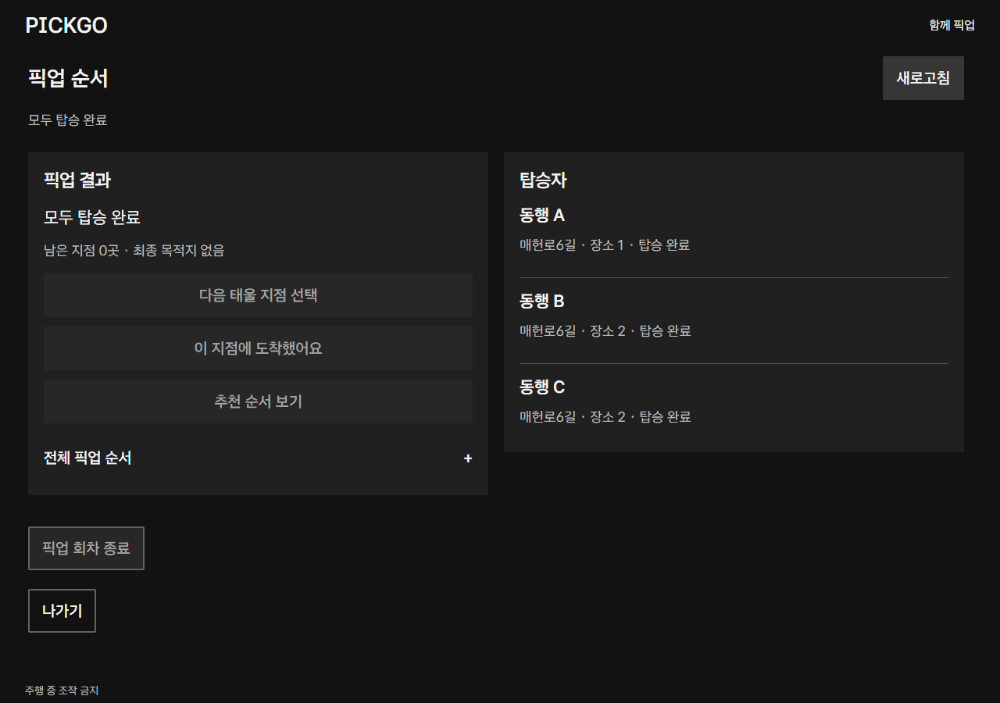

## 5. 현대 내비 안내 시작 — 별도 Android 시연 앱

- 웹 브라우저의 기능이 아닌 별도 Android WebView 앱 기능.
- OSM 지도 좌표로 만든 단일 픽업 회차에서 탑승자 참여·장소 확정.
- 운전자 native 버튼 `확정 지점으로 현대 내비 안내 시작` 선택.
- 최신 회차·확정 좌표·역할·변경 제안 유무를 재검증한 뒤 NaviHelper로 목적지 전달.
- 에뮬레이터에서 현대 내비 목적지 일치·안내 중 상태 관찰.
- 안내 결과를 45초 관찰하고 복귀 시 마지막 관찰 결과 표시.
- 기존 내비 경로가 바뀔 수 있음. 안내 시작은 사용자의 명시 선택으로만 수행.
- 최신 웹 디자인 캡처와 별도 시점의 native 연동 증거를 구분. 동일 최종 제출 빌드의 연속 촬영본은 아님.
- [Android 실행 방법](../../experiments/pickgo-navigation/README.md) · [2026-11-06 검증 기록](../IMPLEMENTATION_STATUS.md).

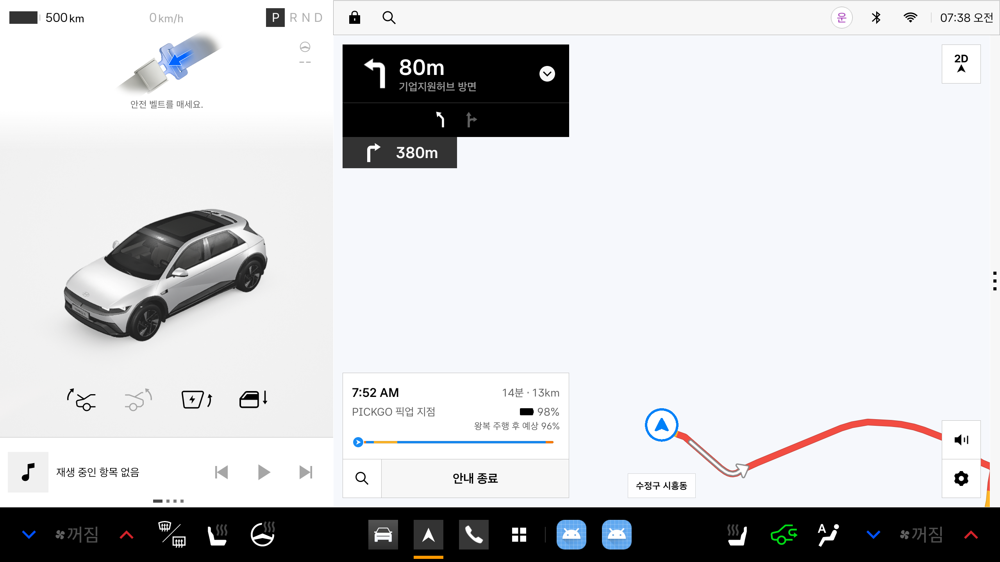

## 6. 추천·연동 준비 기능의 정확한 범위

| 기능 | 현재 상태 | 사용·시연 조건 |
|---|---|---|
| OSM 주변 후보·지도 선택 | 로컬 구현 | 수록 지역 데이터·일부 차단 기준 사용. 합법 정차 보장 아님 |
| 다인 순서 수동 편집 | 일반 화면에서 사용 | 실제 도로시간 없이 사용자 지정 |
| 다인 이동시간 순서 추천 | 합성 모드 구현, 일반 화면 설정 숨김 | 개발 시연용 설정 필요. 기본 모드의 추천은 실제 경로 공급자 미연결 안내 |
| 차량·보행 시간 기반 단일 지점 추천 | 합성 전용 서버와 모듈 구현 | 기본 서버 비활성. 현재 합성 위치 버튼도 일반 화면에서 숨김 |
| 차량 근접 판정 | 합성 관측 전용 모듈·보조 화면 | 실제 Vehicle SDK 미연결. 시연 입력 버튼은 일반 화면에서 숨김 |
| Gleo 조회·도착 명령 | 내부 어댑터·계약 준비 | 실제 Gleo 음성 호출 미연결 |
| routo 검색·지도 | 어댑터·계약 준비 | 키·이용조건·실응답 검증 및 본 화면 통합 미완료 |

- 숨겨진 시연 설정은 일반 사용자가 그대로 클릭할 수 있는 완성 기능으로 소개하지 않음.
- 개발용 세부 안내: [다인 추천](../../experiments/pickup-board/multi/README.md) · [단일 추천](../../experiments/pickup-board/recommendation/README.md) · [Gleo](../../experiments/pickup-board/gleo/README.md) · [routo](../../experiments/pickup-board/routo/README.md).

## 7. 연결 문제·복구

- 연결 실패·오래된 데이터: 현재 미확인 표시, 변경 동작 제한. 연결 복구 후 새로고침.
- 동시에 상대가 상태를 바꾼 경우: 최신 상태를 다시 확인한 뒤 재선택.
- 서버 재시작·회차 만료: 운전자는 새 회차 생성, 탑승자는 새 초대 수신.
- 초대 참여 재시도: 같은 브라우저에서 제한된 복원 지원. 다른 브라우저로 자동 이전되지 않음.
- 기본 서버의 회차는 최대 24시간, 메모리 저장. 영구 보관·회원 계정·운영용 복구 서비스가 아님.
- 지도 배경: 외부 OSM 타일 연결 필요. 로컬 장소 검색 데이터와 배경 지도 네트워크 의존성을 구분.
- 실제 배포 전 남은 작업: 공개 HTTPS·물리폰 전체 흐름·차량 UX 제한·실차·실제 경로시간·다중 경유·release APK 검증.
